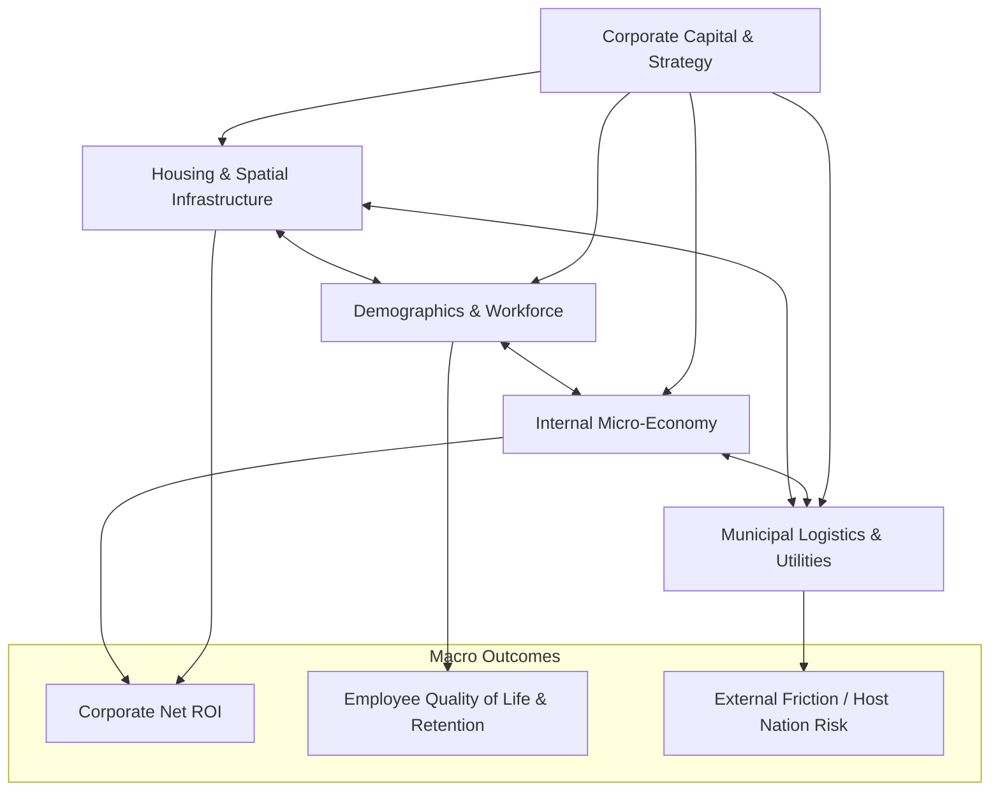

# Corporate Hub Enclave Model (C-HEM)

A macro-system simulation framework exploring future corporate hub operations where enterprises construct self-contained, residential-industrial enclaves (arcologies / company towns 2.0) for their workforce.

---

## 📌 Concept & Rationale

As macro-economic volatility, urbanization costs, housing shortages, and remote-work fragmentation intensify, corporations face rising talent-acquisition overhead and logistical friction. In this projected future, large enterprises transition from leasing urban office towers to building integrated **Corporate Hub Enclaves**.

These hubs combine:
- **High-density housing & social infrastructure** (residential quarters, healthcare, childcare, education).
- **Core operational and computing assets** (datacenters, R&D facilities, manufacturing labs).
- **Self-contained municipal services** (microgrids, vertical food security, internal transit, private governance).
- **Alternative internal micro-economies** (corporate compensation credits, subsidized services, cost-of-living shielding).

This repository houses a **macro idea model** designed to iterate on policy assumptions, financial trade-offs, demographic sustainability, and operational resilience.

---

## 🏗️ Core Subsystems



1. **Demographics & Workforce Dynamics**:
   - Workforce tiering (Core Talent, Leadership, Operations, Service Contractors, Dependents).
   - Retention delta (enclave stickiness vs. turnover).
   - Cohort aging and family unit expansion.

2. **Housing & Facilities Infrastructure**:
   - Living unit distribution (Micro-units, 1BR, Family units).
   - Capital expenditure (CapEx) amortized over enclave lifespan.
   - Spatial expansion milestones and occupancy bottlenecks.

3. **Internal Micro-Economy & Compensation**:
   - Base external wages vs. Enclave subsidized living packages.
   - Corporate savings in facilities lease consolidation and turnover reduction.
   - Purchasing power parity (PPP) inside the enclave vs. volatile external markets.

4. **Municipal Logistics & Resilience**:
   - Power generation (microgrid / nuclear SMR / renewables) and redundancy.
   - Food buffer and supply chain vulnerability index.
   - Internal transit and security perimeter operations.

5. **Governance & External Relations**:
   - Corporate charter compliance, municipal tax treaties with host jurisdictions.
   - Employee mobility rights, exit friction, and burnout indices.

6. **The Hyperscaler Physical Triad & Telemetry Engine (Year 1 Focus)**:
   - Subterranean datacenter continuous stabilization (25–50 MW AI clusters in conductive bedrock).
   - Energy optimization & steam recycling through ORC micro-turbines and regional partner plants.
   - In-house vertical aeroponic food security maintaining the Tier 0 survival floor.
   - Closed-loop assimilation of human biometrics and deliverable telemetry to incrementally tune the enclave while sustaining unbroken "work as usual" engineering velocity.

7. **Resident Well-Being & Human Conditioning (The Anti-Drift Engine)**:
   - Dynamic balance between somatic contentment (deep sleep, dopaminergic culinary rewards, zero chores) and calibrated eustress (synthetic urgency, task complexity escalation, unannounced drills).
   - Keeps residents in the optimal Yerkes-Dodson arousal band: content enough to be loyal and healthy, yet challenged enough to prevent cognitive atrophy and drifting.

---

## 📁 Repository Structure

```
corporate-hub-enclave-model/
├── docs/
│   ├── conceptual_framework.md           # Master thesis, post-friction social contract & system tenets
│   ├── subsystems_spec.md                # Mathematical formulations & subsystem mechanics
│   ├── algorithmic_white_paper.md        # State-space control theory, Lyapunov proofs & inflation invariance
│   ├── control_theory_roi_specification.md# Macroeconomic ROI, capital payback & +a human telemetry valuation
│   ├── resident_wellbeing_conditioning.md# Human conditioning layer: calibrated eustress, contentment floor & anti-drift
│   ├── ai_governance_architecture.md     # Stable LLM core + Edge SLM shell & pragmatic decision auditing
│   ├── year_1_operational_playbook.md    # Hyperscaler foundation, flow calibration & physical triad stabilization
│   ├── separation_exit_protocol.md       # Lower-end fiat conversion, immediate eviction & severance
│   ├── burnout_telemetry_architecture.md # Biometric wearable covenant & zero-friction daily logistics
│   ├── datacenter_thermodynamics.md      # Underground bedrock heat sink & ORC turbine co-generation
│   ├── regional_symbiosis.md             # Subsidized steam, power sharing & external AI partnerships
│   ├── phased_deployment_protocol.md     # Black start, skeleton crew (<=118) & cultural flow seeding
│   ├── demographic_governor.md           # Logarithmic carrying capacity & pre-assimilation vital balances
│   ├── education_automation_governance.md# AI adaptive youth tutoring, robotic groundskeeping & anti-hierarchy charter
│   ├── csuite_override_gauntlet.md       # C-Suite sovereign authority & 5-stage AI bureaucracy gauntlet
│   └── roadmap.md                        # Active development agenda & milestones
├── src/
│   └── enclave_model/
│       ├── __init__.py
│       ├── config.py                     # Config dataclasses (Demographics, Housing, Economy, Ops, Deployment)
│       ├── simulation.py                 # Multi-year discrete step simulator
│       ├── scenarios.py                  # Calibrated macro scenarios
│       ├── core/
│       │   ├── __init__.py
│       │   └── state.py                  # Snapshot tracking (demographics, vital dynamics, balance sheet)
│       └── modules/
│           ├── __init__.py
│           ├── ai_governance.py          # AI audit, credit minting, shift assignment, mobility & education
│           ├── demographics.py           # Logarithmic governor, vital dynamics, retention engine
│           ├── housing.py                # Modular Hab-Cell expansion & CapEx amortization
│           ├── economy.py                # Dual-layer credit economy & regional exit settlements
│           └── operations.py             # Thermodynamic steam recycling, turbine co-gen & municipal OpEx
├── run_model.py                          # CLI simulation runner & CSV export engine
├── requirements.txt                      # Environment dependencies (pure Python core)
└── README.md
```

---

## 🚀 Quick Start

### 1. Requirements
The baseline model runs on standard **Python 3.10+** with zero external dependencies required for core execution.

### 2. Run the Simulation

Execute the baseline multi-scenario simulation:

```bash
python run_model.py
```

### 3. Output Example
The engine runs a multi-year horizon (default: 10 years) comparing:
- **Autonomous Tech Arcology**: High CapEx, fully subsidized housing, high retention.
- **Hybrid Corporate Campus**: Moderate density, mixed external/internal housing.
- **Lean Operations Enclave**: Rapid deployment, operational focus, strict capacity caps.

---

## 🛠️ Working Out the Kinks: How to Contribute

As a macro exploration model, kinks and edge cases are expected:
- Modify parameters in `src/enclave_model/config.py` to test different economic assumptions.
- Add new scenarios in `src/enclave_model/scenarios.py`.
- Formulate hypothesis branches via Git feature branches.

See [docs/roadmap.md](docs/roadmap.md) for the active research agenda.
