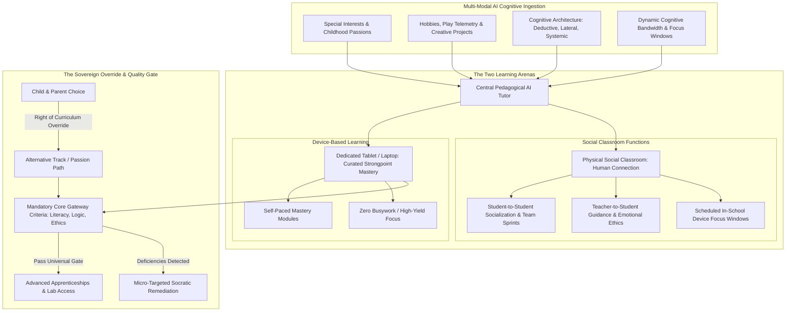
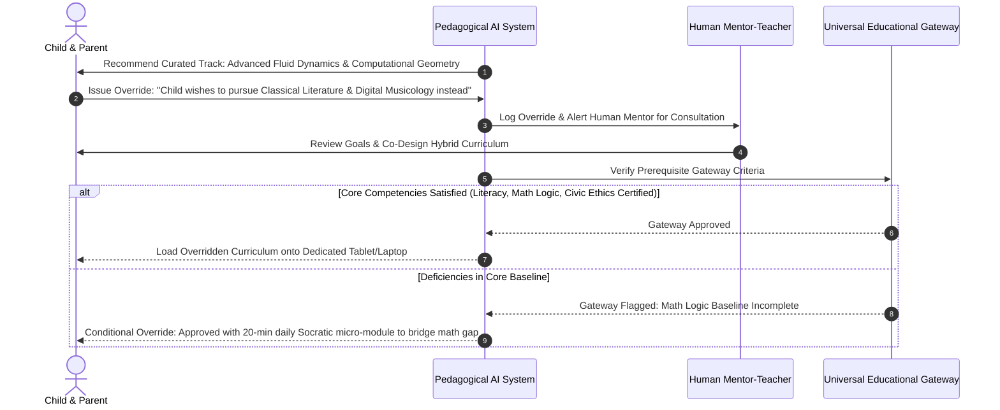

# AI-Driven Youth Educational Framework: Strongpoint Curation, Parental Overrides & Socialized Classrooms

## 1. Executive Summary & Core Philosophy

The educational model of the **Corporate Hub Enclave Model (C-HEM)** moves away from the standardized factory-model schooling of the 19th and 20th centuries. In conventional schooling, children are grouped arbitrarily by birth year, forced through identical rigid curricula, and subjected to standardized test memorization—leading to youth anxiety, alienation, and burnout.

C-HEM replaces this with an **Adaptive Dual-Environment Pedagogical System**:
1. **Asynchronous Cognitive Curricula (Hardware & AI)**: Every child receives a dedicated corporate-provisioned learning tablet/laptop paired with an empathetic, high-reasoning Pedagogical AI tutor. From an early age, the system continuously analyzes:
   - **Special Interests & Spontaneous Passions** (e.g., paleontology, robotics, electronic music, structural design, botany).
   - **Hobbies & Play Behavior** (spatial puzzle solving, digital building, narrative writing, competitive gaming).
   - **Thought Process Patterns** (deductive vs. inductive reasoning, lateral creativity, visual-spatial modeling, systemic debugging).
   - **Real-Time Cognitive Capabilities** (information ingestion velocity, working memory capacity, focus curves).
2. **Synchronous Social Classrooms (Human Connection & Collaboration)**: Physical classrooms are freed from the drudgery of lectures and silent test-taking. They function primarily as **social, emotional, and physical incubators**:
   - Deep student-to-student peer collaboration, team problem solving, and play.
   - High-empathy mentor-teacher interactions, philosophical seminars, and conflict resolution guidance.
   - Dedicated, structured learning blocks where children use their personal devices in quiet focus pods or collaborative tables.
3. **Parental & Student Override Rights with Objective Gateways**:
   - While the AI curates the optimal high-yield pathway, the parent and student retain **ultimate sovereignty to override** and alter course selections.
   - However, to preserve intellectual rigor and developmental milestones, **objective universal baseline criteria** (functional literacy, mathematical logic, critical reasoning, civic ethics) must be mastered and certified before advancing to higher specialized tiers.

---

## 2. Early-Childhood Algorithmic Profiling

From age 4 onward, interaction telemetry from interactive sandbox tools, physical construction blocks, coding puzzles, and language prompts is ingested to build a multi-dimensional cognitive profile:

| Profiling Vector | Telemetry & Observational Signals | AI Pedagogical Translation |
| :--- | :--- | :--- |
| **Special Interests** | Self-directed project topics, video exploration depth, voluntary library queries. | Core curricular themes are anchored in these interests (e.g., teaching physics and geometry through orbital mechanics or racing vehicles). |
| **Hobbies & Play** | Strategy gaming, musical improvisation, miniature building, ecological gardening. | Translates playtime instincts into formal competencies (e.g., strategy gaming mapped to algorithmic systems thinking). |
| **Thought Patterns** | Sequential debugging vs. holistic conceptual leaps; schematic visualizer vs. verbal narrator. | Customizes instructional format (interactive 3D simulations vs. dialectic dialogue). |
| **Cognitive Velocity** | Rate of abstraction mastery, cognitive fatigue points on biometric wearables. | Eliminates arbitrary grade levels; allows rapid acceleration through strongpoints without forcing premature struggle on weak areas. |

---

## 3. The Physical Social Classroom: Restoring Human Connection

In traditional schooling, students sit passively in rows listening to one-size-fits-all lectures, and socialization is often treated as a classroom disruption.

In C-HEM, **the classroom is reimagined as a town square of human connection**:
1. **Teacher as Mentor & Life Coach**:
   - Human educators are relieved of grading standardized worksheets and repetitive lecturing.
   - Teachers dedicate 100% of their time to **individual student mentorship, emotional coaching, philosophical discussions, and guiding collaborative group projects**.
2. **Student-to-Student Socialization**:
   - Classrooms are designed with open lounges, collaborative maker-tables, and outdoor courtyards.
   - Children debate ideas, conduct physical experiments, play instruments, and resolve social disagreements under empathetic guidance.
3. **Dedicated In-School Device Windows**:
   - Class days feature dedicated, structured focus hours (typically 2 to 3 hours during peak morning circadian alertness) where students open their dedicated tablets/laptops.
   - Students work through their personalized AI learning tracks at their own pace, with human teachers and peer study groups immediately available for questions.

---

## 4. Parental & Student Override Protocol with Universal Gateways

To avoid technological determinism or parental disenfranchisement, the system enshrines the **Sovereign Override Policy**:

### 4.1 The Override Principle
- Parents and students can adjust, swap, or completely replace AI-recommended tracks at the start of any learning cycle.
- The AI acts as a **super-advisor**, providing transparent telemetry on why a track was recommended, but it cannot override parental consent.

### 4.2 Mandatory Gateway Criteria for Advancement
While specialization is encouraged, the enclave requires every child to possess the essential cognitive tools needed for autonomous adulthood:
1. **Universal Core Criteria**:
   - **Linguistic & Rhetorical Literacy**: Clear conceptual communication, critical media analysis, and persuasive writing.
   - **Mathematical & Algorithmic Logic**: Numerical reasoning, statistical literacy, and basic algorithmic problem decomposition.
   - **Civic & Ethical Stewardship**: Understanding enclave governance, the post-friction social contract, mutual respect, and ecological sustainability.
   - **Physical & Mental Self-Care**: Ergonomics, emotional regulation, and stress management habits.
2. **Micro-Targeted Remediation**:
   - If a student wishes to override into a specialized field but lacks the foundational baseline, the AI does not fail or hold the student back. It embeds **short, gamified 15-minute daily micro-challenges** into their tablet routine to close the gap without imposing academic punishment.

---

## 5. Sociological Benefits for the Enclave

- **Zero Academic Burnout**: Children spend only 3 to 4.5 hours daily on cognitive tasks, with zero useless homework, allowing the rest of the day for sports, arts, peer play, and family life.
- **Parental Peace of Mind**: Working parents in the enclave know their children are receiving an elite, hyper-personalized education in safe, walkable social classrooms, completely free from the logistical nightmare of school commutes and homework battles.
- **Organic Talent Pipeline**: As youth reach adolescence, their natural mastery allows them to seamlessly apprentice in the subterranean datacenter, vertical farms, or software labs, creating a self-renewing generational leadership loop.
