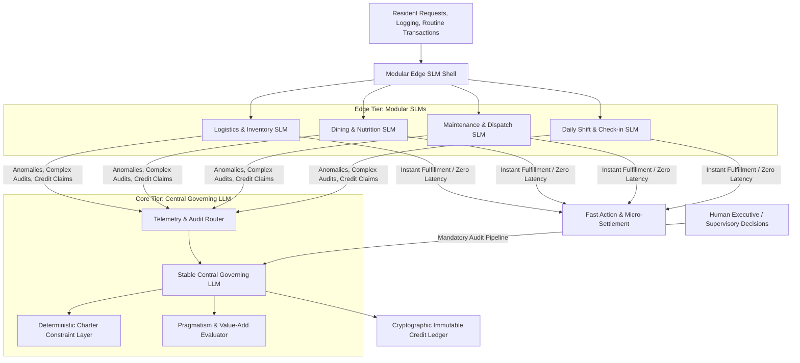
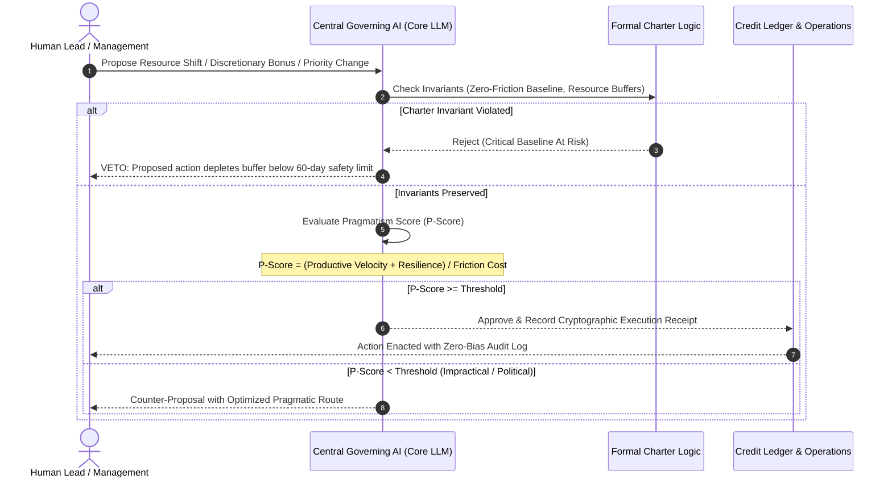

# AI Central Governance & Credit Distribution Architecture

## 1. System Philosophy: Zero-Bias Algorithmic Fairness

In human-managed company towns and historical corporate enclaves, compensation and perks suffered from favoritism, internal politics, nepotism, and subjective evaluation.

In **C-HEM**, the allocation of internal credits ($\mathcal{C}$) is decoupled from interpersonal hierarchy and transferred to an objective, self-governing **Central Governing AI (C-GAI)**.

> **Foundational Axiom**: Basic survival (Tier 0: shelter, food, water, healthcare, logistics) is guaranteed unconditionally to all residents. Discretionary credits ($\mathcal{C}$) are issued with **zero human bias**, computed strictly from verified productive work inputs, civic contributions, and system stewardship.

---

## 2. Multi-Tiered AI Compute Stack: Stable LLM Core + Modular SLM Shell

To ensure extreme stability, resilience against hallucination, low latency, and energy efficiency, the AI governance system is engineered as a **heterogeneous multi-tiered stack**:

### 2.1 The Modular SLM Shell (Small Language Models)
- **Role**: High-speed, local inferencing running on edge compute nodes embedded directly in residential Hab-Cells and operational zones.
- **Scope**:
  - Handles 90–95% of daily resident queries (meal ordering, transit booking, routine work shift logging, maintenance ticket generation).
  - Extremely lightweight (1B–7B parameter models fine-tuned on hyper-specific domain tasks).
  - Ensures near-zero latency, negligible power draw, and full local survivability if external communication links degrade.
  - Zero authority to issue unverified credits or override charter constraints.

### 2.2 The Stable Core LLM (Central Governance Intelligence)
- **Role**: High-reasoning, parameter-frozen foundation intelligence operating in an isolated, secure computational enclave.
- **Design Parameters**:
  - **Stability First**: Strict deterministic generation (low/zero temperature) coupled with formalized verification constraints (formal logic / symbolic verification layers).
  - **No Drift / Hallucination Shield**: Operating under immutable prompt charters and formal mathematical checkrails; weights are version-pinned and audited.
  - **Zero Bias**: Evaluates inputs based on verifiable telemetry (code commits, hardware assembly completions, energy savings, maintenance resolution times, medical patient hours) rather than interpersonal lobbying.

---

## 3. Auditing Human Decisions for Pragmatism

A central thesis of the enclave is that **purely human management is vulnerable to emotional volatility, political ego, and short-term quarterly myopia**, whereas **pure unconstrained automation lacks systemic sanity checks**.

Therefore, the system institutes a **Pragmatic Dual-Key Audit Pipeline**:

### 3.1 The Pragmatism Metrics (P-Score)
When human leaders or department heads make strategic proposals (e.g., reallocating capital, granting special compensation, shifting production quotas, modifying work protocols), the Central Governing AI audits the proposal across 4 pragmatic dimensions:
1. **Resource Preservation Factor**: Does this decision jeopardize the guaranteed Tier 0 floor (food, water, power, housing buffers)? If yes $\rightarrow$ **Automatic Veto**.
2. **Velocity vs. Friction Delta**: Does the initiative verifiably increase collective output and efficiency without inflicting asymmetric burnout on dependent cohorts?
3. **Merit & Equity Verification**: Are requested bonus allocations supported by objective telemetry and deliverable validation, or does the data indicate interpersonal cronyism?
4. **Long-Term Enclave Solvency**: Does this choice create downstream CapEx/OpEx liabilities over a 5–20 year operational horizon?

### 3.2 Transparent Explanations
Whenever the Governing AI audits, modifies, or approves a human decision, it outputs an **Immutable Audit Brief**:
- Mathematical grounds for evaluation.
- Telemetry references.
- Complete chain-of-thought rationale accessible to the Resident Council and affected workers.

---

## 4. Work Input Verification & Credit Allocation Formula

The AI computes credit allocation ($\mathcal{C}_{\text{allocated}}$) for each resident worker per pay epoch:

$$\mathcal{C}_{\text{total}} = \mathcal{C}_{\text{base\_input}} + \mathcal{C}_{\text{milestone}} + \mathcal{C}_{\text{civic}} + \mathcal{C}_{\text{innovation}}$$

Where:
- $\mathcal{C}_{\text{base\_input}}$: Standard credit baseline for fulfilled contractual shift hours / standard task completion.
- $\mathcal{C}_{\text{milestone}}$: Objective deliverable completion (verified by code tests, QA benchmarks, hardware pass-rates, patient satisfaction metrics).
- $\mathcal{C}_{\text{civic}}$: Unsung community maintenance (teaching youth, organizing social cohesion events, participating in dispute reconciliation, volunteering for emergency response drills).
- $\mathcal{C}_{\text{innovation}}$: Royalties paid back to the worker for solutions that reduced enclave energy, water, or logistics costs.

### Anti-Gaming & Anomaly Detection
The Core AI continuously monitors for collusion, metric hacking, or task manipulation:
- Cross-validates peer inputs against physical sensors and telemetry (e.g., smart tools, energy meters, digital check-ins).
- Automatically normalizes grading scales across different departments to prevent grade inflation.

---

## 5. Non-Hierarchical Task Routing & Conflict-Free Peer Arbitration

To permanently eradicate corporate politics, favoritism, and interpersonal conflict, the Enclave Charter explicitly bans traditional human-to-human managerial authority.

### 5.1 Algorithmic Task Routing
1. **Strategic Decomposition**: Corporate executive directives are decomposed by the Central Governing AI into modular sprint packages with clearly defined interfaces and test criteria.
2. **Strongpoint Matching**: Sprints are assigned directly to technical specialists and cross-functional teams based on proven skill telemetry, chronotype compatibility, and current cognitive bandwidth.
3. **Equal Peer Collaboration**: Collaborators work as functional equals. Technical leads act as architectural consultants, possessing zero structural power to penalize, grade, or reassign their peers.

### 5.2 Impartial AI Dispute Arbitration
- When technical disagreements or interpersonal friction emerge between colleagues, neither party can exercise managerial veto power.
- The dispute is ingested by the Governing AI's **Arbitration Pipeline**:
  - Technical claims are simulated and stress-tested against empirical codebase benchmarks, thermodynamic models, or QA pass rates.
  - If social or communication friction is detected via wearable stress telemetry, the AI transparently restructures project boundaries—routing individuals to independent parallel modules without punitive career impact.
- Eliminates 100% of executive posturing, political backstabbing, and subjective managerial bias.

---

## 6. The AI as the Sole "Boss": Automated Workflow & The Prompt-Driven Paradigm

Under C-HEM, human-to-human supervision is replaced with an automated **Prompt-Driven Execution Pipeline**:
- **The Core Axiom**: The "Boss" is the Central Governing AI and its modular Edge SLMs.
- **The Employee's Daily Duty**: The employee is not required to navigate political hierarchies, play status games, or guess what their manager wants. **The employee simply logs in and follows the curated prompts.**
- **The Automated Prompt Lifecycle**:
  1. *Prompt Ingestion & Context Provision*: The AI presents the exact technical objective, prerequisite data, tool integrations, and clear test acceptance criteria.
  2. *Autonomous Focus Block*: The worker applies their specialized craftsmanship (software engineering, hardware wiring, bioreactor calibration, clinical analysis) directly to the prompt.
  3. *Zero-Subjectivity Verification*: Progress is validated by objective telemetry (automated unit test suites, sensor readings, thermodynamic telemetry).
  4. *Instant Ledger Settlement*: When the prompt's criteria pass, the AI credits the employee's ledger immediately and dispatches the subsequent prompt or scheduled rest interval.
- **Cognitive Flow & Conflict Elimination**: By decoupling daily work execution from human egos, emotional friction between coworkers drops to near zero. Tasks are clear, criteria are transparent, and work output is universally recognized.
