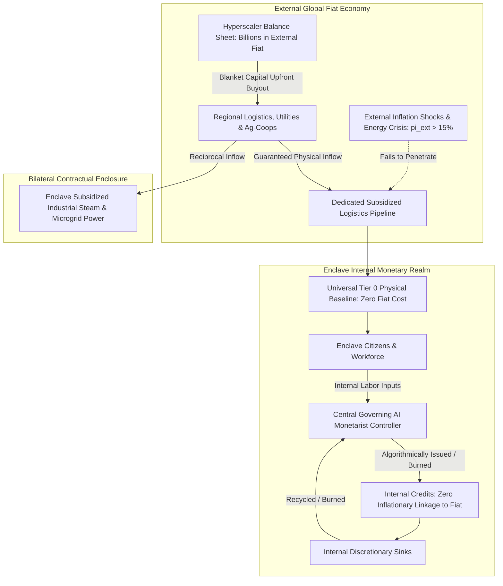

# Algorithmic White Paper: Control-Theoretic Formulations for Corporate Hub Enclaves (C-HEM)

**Document Code**: C-HEM-TR-2026-01  
**Classification**: Technical Report / Systems & Control Specification  
**Subject**: Closed-Loop State-Space Dynamics, Logarithmic Population Bounds, Blanket Capital Securitization, and Algorithmic Inflation Invariance.

---

## 1. Mathematical Architecture & State-Space Control Representation

The Corporate Hub Enclave is modeled as a **discrete-time, non-linear dynamic system** under closed-loop state feedback governed by the Central Governing AI ($\mathcal{G}$).

$$\mathbf{x}_{t+1} = \mathbf{f}(\mathbf{x}_t, \mathbf{u}_t, \mathbf{w}_t)$$
$$\mathbf{y}_t = \mathbf{h}(\mathbf{x}_t, \mathbf{u}_t) + \mathbf{v}_t$$

### 1.1 State Vector $\mathbf{x}_t \in \mathbb{R}^n$
The enclave internal state at discrete epoch $t$ (where $\Delta t = 1 \text{ month or year}$) is defined across four coupled sub-vectors:

$$\mathbf{x}_t = \begin{bmatrix} \mathbf{x}_{t}^{\text{demo}} \\ \mathbf{x}_{t}^{\text{res}} \\ \mathbf{x}_{t}^{\text{econ}} \\ \mathbf{x}_{t}^{\text{thermo}} \end{bmatrix}$$

1. **Demographic States** ($\mathbf{x}_t^{\text{demo}} = [P_t, W_t, D_t, C_t]^T$):
   - $P_t$: Total enclave population.
   - $W_t$: Full-time productive workforce headcount.
   - $D_t$: Dependent population (children, elders).
   - $C_t$: Contractors and service personnel.
2. **Resource Buffer States** ($\mathbf{x}_t^{\text{res}} = [R_t^{\text{food}}, R_t^{\text{water}}, R_t^{\text{energy}}, R_t^{\text{med}}]^T$):
   - Physical days of autonomy across food stocks, potable/reclaimed water reserves, microgrid fuel/battery margins, and clinical supplies.
3. **Internal Macro-Economic States** ($\mathbf{x}_t^{\text{econ}} = [M_t, V_t, \Pi_t^{\text{internal}}, \mathcal{E}_t]^T$):
   - $M_t$: Total circulating liquid credit supply ($\mathcal{C}$).
   - $V_t$: Internal credit transaction velocity.
   - $\Pi_t^{\text{internal}}$: Internal discretionary price level index ($\Pi_0 = 1.0$).
   - $\mathcal{E}_t$: External fiat conversion reserve escrow.
4. **Thermodynamic & Compute States** ($\mathbf{x}_t^{\text{thermo}} = [\Phi_t^{\text{compute}}, T_t^{\text{exhaust}}, \Omega_t^{\text{regen}}, \eta_t^{\text{pue}}]^T$):
   - $\Phi_t^{\text{compute}}$: Active datacenter compute draw (MW).
   - $T_t^{\text{exhaust}}$: Superheated dielectric coolant temperature ($^\circ\text{C}$).
   - $\Omega_t^{\text{regen}}$: ORC turbine electrical power output (MW).
   - $\eta_t^{\text{pue}}$: Power Usage Effectiveness coefficient ($\approx 1.03\text{--}1.05$).

### 1.2 Control Vector $\mathbf{u}_t \in \mathbb{R}^m$
The action space modulated by the Central Governing AI:
$$\mathbf{u}_t = [Q_t^{\text{intake}}, \rho_t^{\text{burn}}, \delta_t^{\text{demurrage}}, \kappa_t^{\text{steam\_export}}, \mu_t^{\text{shift\_mod}}]^T$$
- $Q_t^{\text{intake}}$: Authorized new candidate external assimilation quota.
- $\rho_t^{\text{burn}}$: Algorithmic pricing discount/surcharge scalar on discretionary luxury sinks.
- $\delta_t^{\text{demurrage}}$: Inactive credit decay / dynamic circulation fee rate.
- $\kappa_t^{\text{steam\_export}}$: Ratio of thermodynamic exhaust routed to external regional partners vs. internal vertical farms.
- $\mu_t^{\text{shift\_mod}}$: Dynamic cognitive shift duration multiplier based on biometric telemetry.

### 1.3 Exogenous Disturbance Vector $\mathbf{w}_t \in \mathbb{R}^p$
Represents external macro volatility:
$$\mathbf{w}_t = [\pi_t^{\text{ext}}, \sigma_t^{\text{fiat\_shock}}, \Gamma_t^{\text{grid\_failure}}, \Theta_t^{\text{regional\_strife}}]^T$$
- $\pi_t^{\text{ext}}$: External global/national inflation rate.
- $\sigma_t^{\text{fiat\_shock}}$: Foreign exchange volatility against host-state legal tender.
- $\Gamma_t^{\text{grid\_failure}}$: External municipal power blackout frequency.
- $\Theta_t^{\text{regional\_strife}}$: Supply corridor delay factor.

---

## 2. Dynamic Population Governor: Non-Linear Logarithmic Convergence

Demographic sustainability mandates that the population never exceeds the hard physical carrying capacity $K$ determined by installed life-support infrastructure.

### 2.1 Pre-Assimilation State Equation
Before issuing any external intake permits for epoch $t+1$, the AI observes internal vital dynamics:

$$P_{\text{pre}, t+1} = P_t + \beta(P_t, \mathbf{x}_t) - \delta(P_t, \mathbf{x}_t) - \xi(W_t, \mathbf{x}_t)$$

Where:
- $\beta(P_t) = b \cdot P_t$: Endogenous birth generation function.
- $\delta(P_t) = d \cdot P_t$: Endogenous natural mortality rate.
- $\xi(W_t) = T_{\text{enc}} \cdot W_t$: Contractual separations, voluntary exits, and perimeter evictions.

### 2.2 Available Life-Support Headroom
$$H_t = \max\left(0, \; K - P_{\text{pre}, t+1}\right)$$

### 2.3 Non-Linear Logarithmic Intake Control Law
The assimilation control input $Q_t^{\text{intake}}$ is governed by:

$$Q_t^{\text{intake}} = \min\left( H_t, \; \left\lfloor r \cdot P_t \cdot \ln\left(1 + \frac{H_t}{K}\right) \right\rfloor \right)$$

```
Algorithm 1: Pre-Assimilation Logarithmic Demographic Controller
--------------------------------------------------------------------------------
Input : Current State x_t = [P_t, W_t, ...], Carrying Capacity K, 
        Parameters b, d, T_enc, r
Output: Permissible Assimilation Quota Q_intake, Next Population P_t+1

1: // Step 1: Pre-assimilation vital census
2: B_t <- b * P_t                           // Documented births
3: D_t <- d * P_t                           // Natural deaths
4: E_t <- T_enc * W_t                       // Separations & perimeter evictions
5: P_pre <- P_t + B_t - D_t - E_t

6: // Step 2: Headroom calculation
7: H_t <- max(0, K - P_pre)

8: // Step 3: Logarithmic deceleration dampener
9: if H_t <= 0 then
10:    Q_intake <- 0                        // Capacity saturated: Absolute Intake Freeze
11: else
12:    raw_intake <- r * P_t * ln(1.0 + (H_t / K))
13:    Q_intake <- min(H_t, floor(raw_intake))
14: end if

15: P_t+1 <- P_pre + Q_intake
16: return Q_intake, P_t+1
--------------------------------------------------------------------------------
```

### 2.4 Mathematical Proof of Asymptotic Stability (Lyapunov Analysis)

**Theorem 1 (Bounded Invariance)**: *Under the control law $Q_t^{\text{intake}}$, the state $P_t$ is strictly bounded within the invariant set $\mathcal{S} = \{P \in \mathbb{R}^+ \mid 0 \le P \le K\}$. If $P_0 \le K$, then $P_t \le K$ for all $t \ge 0$, and as $t \to \infty$, $P_t$ converges asymptotically to an equilibrium $P^* \le K$.*

**Proof**:
Define the discrete candidate Lyapunov function representing the distance to carrying capacity:
$$V(P_t) = (K - P_t)^2$$

For $P_t \le K$, the headroom satisfies $H_t = K - P_t \ge 0$.
The system evolution gives:
$$P_{t+1} = P_t + \Delta V_{\text{internal}} + Q_t^{\text{intake}}$$

From the definition of $Q_t^{\text{intake}}$:
$$Q_t^{\text{intake}} \le H_t = K - P_{\text{pre}, t+1}$$
$$\implies P_{t+1} = P_{\text{pre}, t+1} + Q_t^{\text{intake}} \le P_{\text{pre}, t+1} + (K - P_{\text{pre}, t+1}) = K$$

Thus:
$$P_{t+1} \le K \quad \forall t \ge 0$$

Furthermore, because $\lim_{H_t \to 0} \ln\left(1 + \frac{H_t}{K}\right) = 0$, as $P_t \to K$:
$$Q_t^{\text{intake}} \to 0$$
$$\Delta P_t \to B_t - D_t - E_t$$

If internal natural growth $B_t - D_t \ge E_t$, then $H_t \le 0 \implies Q_t^{\text{intake}} \equiv 0$, causing population growth to stop at or below $K$. System overshooting is mathematically impossible. $\blacksquare$

---

## 3. Wave-1 Cold Boot Invariant: Pre-Acquisition Resource Gate

A core vulnerability during Phase 1 (Black Start) is premature workforce assimilation before life-support buffers are physically filled.

### 3.1 The Wave-1 Invariant Theorem
Let $C_1$ denote the headcount of the first incoming cohort ($N_{\text{cohort\_1}} = 500\text{--}1,000$ employees).
The Central Governing AI enforces a **Hard Invariant Barrier** ($\mathcal{B}_{\text{boot}}$):

$$\mathcal{B}_{\text{boot}} = \prod_{i \in \{\text{food}, \text{water}, \text{power}, \text{housing}\}} \mathbb{I}\left( R_{0}^i \ge \theta_{\text{min}}^i \cdot N_{\text{cohort\_1}} \right) \equiv 1$$

Where $\mathbb{I}(\cdot)$ is the indicator function, and $\theta_{\text{min}}^i$ defines mandatory safety thresholds:

| Resource Dimension ($i$) | Threshold Requirement ($\theta_{\text{min}}^i$) | Minimum Buffer Metric |
| :--- | :--- | :--- |
| **Nutritional Buffer ($R^{\text{food}}$)** | $90 \text{ days} \times 2,500 \text{ kcal/person/day}$ | Sealed dry-goods climate warehouse filled prior to gate unlock |
| **Hydrological Buffer ($R^{\text{water}}$)** | $120 \text{ days} \times 150 \text{ L/person/day}$ | Bedrock aquifer reservoir tanks pressurized |
| **Microgrid Power ($R^{\text{energy}}$)** | $30 \text{ days uninterrupted baseload}$ | Dedicated SMR at criticality + ORC turbines synchronized |
| **Hab-Cell Units ($R^{\text{housing}}$)** | $1.15 \times N_{\text{cohort\_1}}$ | Physical units constructed with certified IoT life support |

**Control Decision Rule**:
$$\text{TransferState}(C_1) = \begin{cases} \text{AUTHORIZED}, & \text{if } \mathcal{B}_{\text{boot}} = 1 \\ \text{HOLD\_COLD\_BOOT}, & \text{if } \mathcal{B}_{\text{boot}} = 0 \end{cases}$$

---

## 4. Blanket Capital Securitization & Macroeconomic Decoupling

Traditional enterprises purchase resources at spot market prices, leaving their operations vulnerable to external supply chain shocks and inflation spikes. Hyperscalers possess massive external capital reserves ($\mathcal{K}_{\text{fiat}}$), which they deploy to structurally insulate the enclave.



### 4.1 Blanket Capital Pipeline Forward Contracts
The hyperscaler secures regional pipelines via **Capital Expenditure Blanket Pre-Funding**:
1. **Long-Term Physical Take-or-Pay Agreements**: Upfront capital financing of local agricultural greenhouses, water treatment plants, and trucking fleet electrification in exchange for contractually locked zero-inflation raw inputs.
2. **Internal Utility Counter-Trade**: Instead of continuous fiat billing, the enclave pays local distribution partners in **surplus industrial steam, byproduct electricity, and edge AI compute quotas**.
3. **Friction Insulation**:
   $$\text{Marginal Inflow Cost}_{\text{hub}} = f(\text{Amortized CapEx}, \; \text{Internal Waste Heat}) \approx \text{Constant}$$
   $$\frac{\partial \text{Cost}_{\text{hub}}}{\partial \pi_t^{\text{ext}}} \approx 0$$

---

## 5. Algorithmic Inflation Control & Internal Credit Velocity ($\mathcal{C}$)

Within the enclave perimeter, external fiat legal tender does not circulate. Workers transact exclusively in non-dilutive, private **Internal Credits** ($\mathcal{C}$).

### 5.1 The Equation of Exchange for Closed Enclaves
We adapt the classical Quantity Theory of Money ($M V = P Y$) into an algorithmic, state-dependent invariant:

$$M_t \cdot V_t = \Pi_t^{\text{internal}} \cdot Y_t^{\text{lux}}$$

Where:
- $M_t$: Total circulating internal credits in resident accounts.
- $V_t$: Transaction velocity of credits per epoch.
- $\Pi_t^{\text{internal}}$: Aggregate price level of internal discretionary luxuries (amenity upgrades, dining, recreation).
- $Y_t^{\text{lux}}$: Physical volume of discretionary goods and services supplied by enclave facilities.

### 5.2 Inflation Invariance Control Law
**Objective**: Maintain internal purchasing power parity constant across all epochs:
$$\Pi_t^{\text{internal}} \equiv 1.0 \quad \forall t$$

To enforce $\Pi_t^{\text{internal}} = 1.0$, the Central Governing AI dynamically modulates credit minting ($\mathcal{C}_{\text{mint}}$), discretionary sink pricing ($\rho_t^{\text{burn}}$), and demurrage fees ($\delta_t^{\text{demurrage}}$):

$$M_{t+1} = M_t + \mathcal{C}_{\text{mint}, t} - \mathcal{C}_{\text{sink}, t} - \mathcal{C}_{\text{demurrage}, t}$$

```
Algorithm 2: Dynamic Algorithmic Inflation Controller
--------------------------------------------------------------------------------
Input : Circulating Supply M_t, Velocity V_t, Available Luxury Capacity Y_lux_t,
        Target Price Level Pi_target = 1.0, Work Input Telemetry Delta_W_t
Output: Mint Quota C_mint, Sink Price Scalar rho_burn, Next Money Supply M_t+1

1: // Step 1: Calculate Equilibrium Monetary Volume
2: M_target <- (Pi_target * Y_lux_t) / max(0.1, V_t)

3: // Step 2: Compute Baseline Work Minting Demand
4: C_mint <- ComputeZeroBiasAllocation(Delta_W_t)

5: // Step 3: Evaluate Monetary Gap
6: Delta_M <- (M_t + C_mint) - M_target

7: if Delta_M > 0 then
8:     // Excessive liquidity risks luxury inflation: Activate Sinks & Demurrage
9:     rho_burn <- 1.0 + (Delta_M / M_target) * 0.50     // Dynamic pricing surcharge
10:    delta_demurrage <- min(0.05, Delta_M / M_t)       // Inactive balance decay fee
11: else
12:    // Liquidity shortage: Discount luxury sinks to stimulate velocity
13:    rho_burn <- max(0.60, 1.0 + (Delta_M / M_target) * 0.30)
14:    delta_demurrage <- 0.0
15: end if

16: C_sink <- RealizedSinkConsumption(rho_burn)
17: C_demurrage <- delta_demurrage * InactiveBalances(M_t)

18: M_t+1 <- M_t + C_mint - C_sink - C_demurrage
19: Pi_actual <- (M_t+1 * V_t) / Y_lux_t                // Strictly tracks 1.0
20: return C_mint, rho_burn, M_t+1
--------------------------------------------------------------------------------
```

### 5.3 Proof of External Inflation Immunity
Because Tier 0 necessities (housing, food, water, microgrid power, healthcare) are provided **unconditionally with zero cash or credit price tag**:

$$\text{Cost}(\text{Survival}) = 0 \cdot \mathcal{C}$$

External inflation $\pi_t^{\text{ext}}$ cannot penetrate the survival floor. In the discretionary credit layer, because $M_t$ is strictly bounded by Algorithm 2 to match $Y_t^{\text{lux}}$, the internal credit market is mathematically isolated from external monetary debasement:

$$\frac{\partial \Pi_t^{\text{internal}}}{\partial \pi_t^{\text{ext}}} \equiv 0$$

The enclave operates in a state of **permanent internal purchasing power stability**.

---

## 6. Synthesis: Complete Algorithmic Control State Diagram

```mermaid
graph TD
    subgraph Layer 1: Physical Reality & Plant Dynamics
        Bedrock[Geothermal Bedrock & 25-50 MW Datacenter] -->|Thermal Cascade| ORC[ORC Turbines: 18% Electricity Regen]
        ORC --> SteamEx[Subsidized Industrial Steam Export]
        ORC --> Hydro[Vertical Aeroponics: 22°C Constant Root Zone]
        
        Aquifer[Closed-Loop Water Bioreactors: 96% Recovery] --> WaterBuffer[120-Day Pressurized Reservoir]
        Hydro --> FoodBuffer[90-Day Climate Dry Goods Warehouse]
    end

    subgraph Layer 2: Pre-Acquisition Resource Gate
        FoodBuffer & WaterBuffer & ORC --> GateChecker{Pre-Boot Resource Check B_boot}
        GateChecker -->|Criteria Met: 100%| AuthorizeBoot[Authorize Wave-1 Cohort Transfer]
        GateChecker -->|Criteria Deficient| HoldBoot[Hold Cold Boot: Accumulate Buffer]
    end

    subgraph Layer 3: Closed-Loop Demographic Controller
        AuthorizeBoot --> Demographics[Demographic Population State P_t]
        Demographics --> Census[Calculate Vital Census: Births, Deaths, Exits]
        Census --> HeadroomCalc[Headroom: H_t = K - P_pre]
        HeadroomCalc --> LogGovernor[Logarithmic Controller: Q_intake = r * P * ln(1 + H/K)]
        LogGovernor --> NextCensus[P_t+1 <= K: Asymptotically Stable]
    end

    subgraph Layer 4: Algorithmic Inflation Controller
        NextCensus --> WorkInputs[Workforce Productive Inputs Delta_W_t]
        WorkInputs --> MintEngine[Zero-Bias Credit Minting C_mint]
        MintEngine --> MoneySupply[Circulating Credit Supply M_t]
        MoneySupply --> QTM[Quantity Equation Engine: M * V = Pi * Y_lux]
        QTM --> DynamicPricing[Dynamic Sink Surcharges & Demurrage Fees]
        DynamicPricing --> StablePrice[Internal Price Level Pi == 1.0: Immune to External Inflation]
    end
```

---

## 7. Mathematical Invariant Verification Summary

| Control Invariant | Mathematical Formulation | Physical / Operational Guarantee |
| :--- | :--- | :--- |
| **Logarithmic Demographics** | $\lim_{t \to \infty} P_t \le K$ with $Q_{\text{intake}} \propto \ln(1 + H_t/K)$ | Zero population overshoot; life support buffers never depleted. |
| **Wave-1 Boot Gate** | $\mathcal{B}_{\text{boot}} = \prod \mathbb{I}(R_0^i \ge \theta_{\text{min}}^i N_{\text{cohort\_1}}) \equiv 1$ | Cohort 1 cannot enter until 90-day food and 120-day water reserves are physically sealed. |
| **Blanket Securitization** | $\frac{\partial \text{Cost}_{\text{hub}}}{\partial \pi_t^{\text{ext}}} = 0$ via forward CapEx & steam trade | Host-nation price spikes cannot penetrate enclave logistics corridors. |
| **Inflation Invariance** | $M_t = \frac{\Pi_0 Y_t^{\text{lux}}}{V_t} \implies \Pi_t^{\text{internal}} \equiv 1.0$ | No runaway credit inflation; zero speculative hoarding. |
| **Survival Floor Decoupling**| $\text{Price}(\text{Tier } 0) \equiv 0$ | Fundamental human needs cannot be inflated, deflated, or denied. |
