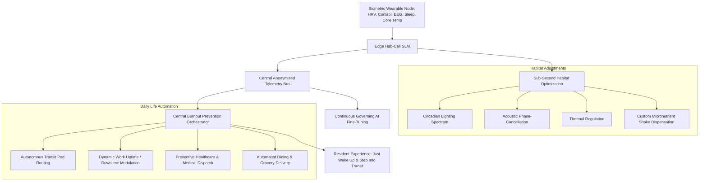
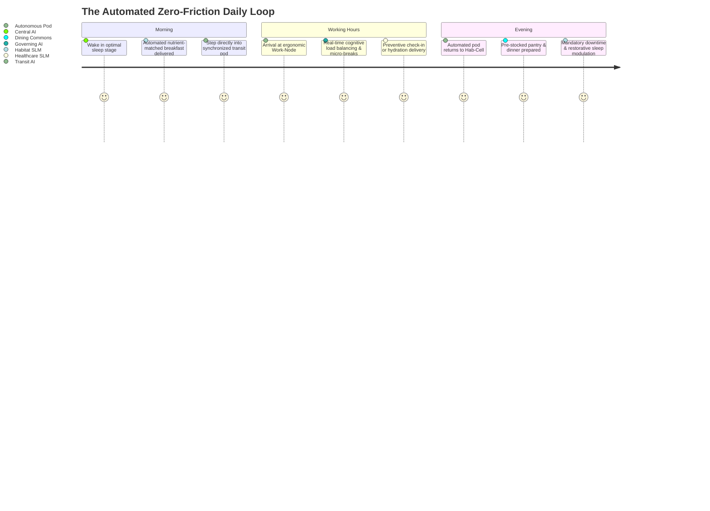

# Burnout Prevention & Biometric Telemetry Architecture

## 1. System Philosophy: Zero-Friction Existence

The primary driver of employee burnout in traditional distributed economies is not merely hard work—it is the **cognitive drag of logistical existence**:
- Deciding what to eat, shopping, cooking, and cleaning.
- Navigating traffic, parking, and transit delays.
- Scheduling medical appointments, refilling prescriptions, and managing insurance claims.
- Managing sleep hygiene, circadian disruption, and domestic chores.

In the **Corporate Hub Enclave Model (C-HEM)**, the Central Governing AI systematically automates and schedules these cognitive burdens.

> **The Resident's Sole Responsibility**:
> The individual's only operational responsibility is **waking up and stepping into automated transportation**. Every logistical dependency before, during, and after that moment is orchestrated by the AI.

---

## 2. The Wearable Telemetry Node & Enclave Covenant

### 2.1 The Enclave Covenant (Mandatory Entry Condition)
Entry into the corporate enclave is contingent upon a legally binding social and computational contract:
1. **Universal Continuous Telemetry**: Every resident must wear an enterprise-issued biometric wearable (e.g., wristband or neural-dermal sensor) at all times while residing inside the enclave perimeter.
2. **AI Training Exclusivity**: 100% of human telemetry (biometrics, sleep stages, stress markers, transit habits, nutrition intake, recovery curves) is fed into the Central Governing AI and its modular SLM shell to optimize real-time operations and train future model iterations.
3. **Explicit Data Boundary**: This telemetry is legally restricted to internal enclave life-support optimization, scheduling, and model training—it cannot be monetized or sold to third-party external brokers.

---

## 3. Real-Time Telemetry & Ambient Habitat Optimization

The wearable tracks multi-modal biological metrics:
- **Heart Rate Variability (HRV)** and pulse-wave velocity (autonomic nervous system stress).
- **Galvanic Skin Response & Cortisol Biomarkers** (acute cognitive load).
- **Sleep Architecture** (REM, deep slow-wave sleep, micro-awakenings).
- **Physical Activity & Postural Fatigue** (musculoskeletal strain).

### 3.1 Habitat Response Loop
When the wearable detects elevated fatigue or autonomic strain:
- **Sleep Cycle Precision**: Smart residential alarms do not wake the worker at a rigid time; they wait for the optimal phase of light sleep within a 20-minute window.
- **Ambient Adaptation**: The residential Hab-Cell dynamically shifts ambient temperature, air ionization, and blue-light filtration to deepen slow-wave physical recovery.
- **Micro-Nutrition Delivery**: Dining commons and habitat dispensers synthesize tailored meals matching caloric burn and electrolyte/vitamin deficits measured over the preceding 24 hours.

---

## 4. End-to-End Daily Automation: The "Zero-Effort" Day

1. **Autonomous Transit Synchronization**:
   - The worker never waits for a shuttle, looks at a bus schedule, or drives a vehicle.
   - An autonomous electric pod arrives at the Hab-Cell elevator threshold precisely as the resident exits their door.
2. **Dynamic Work Uptime / Downtime Modulation**:
   - If the Governing AI observes high cognitive fatigue (sustained drop in HRV and cognitive reaction velocity), it **dynamically adjusts work shift length**.
   - The AI automatically reschedules non-critical meetings, prompts micro-breaks, or injects mandatory half-day recovery protocols without managerial penalty.
3. **Automated Groceries & Preventive Medicine**:
   - Pantry staples, fresh produce, and tailored meals restock automatically via pneumatic corridors.
   - Clinical check-ups are scheduled automatically based on early blood/biometric biomarkers before clinical symptoms manifest.

---

## 5. Sociological Kink & Guardrail: Voluntary vs. Dystopian Friction

While telemetry optimization radically eliminates burnout, it introduces psychological friction if unaddressed:
1. **The "Surveillance Panopticon" Anxiety**:
   - *Concern*: Workers fear that poor biometrics will lead to instant termination or demotion.
   - *System Guardrail*: Biometric telemetry is firewalled from human managers. Managers only see team deliverable throughput, never heart rates or sleep data. The AI uses biometric data exclusively for protective health and scheduling modulation.
2. **Right to Disconnect / Low-Stimulus Mode**:
   - During scheduled downtime, the habitat enters "sanctuary mode"—work communications are cryptographically suppressed, ensuring workers have total mental disconnect from professional tasks.
