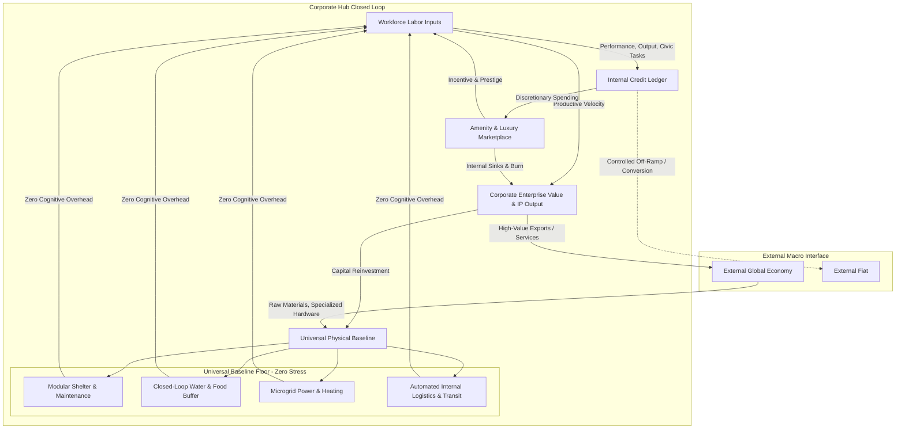
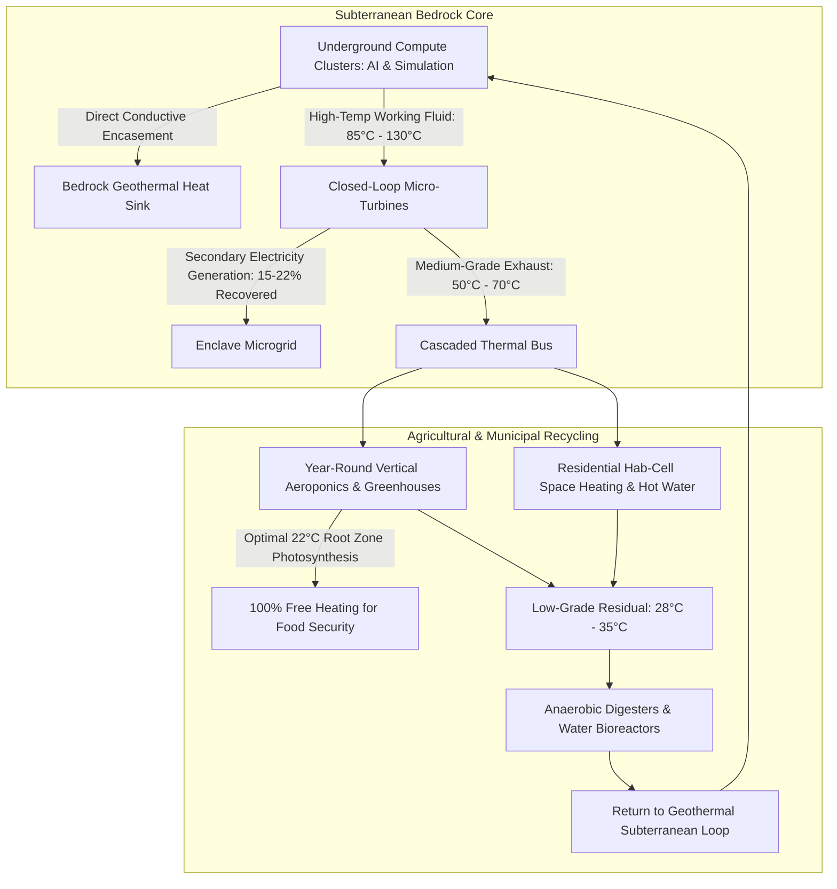

# Conceptual Framework: Corporate Hub Enclaves (C-HEM)

## 1. Executive Summary & Foundational Vision

The **Corporate Hub Enclave Model (C-HEM)** models a future corporate ecosystem where enterprises directly build, operate, and govern high-density, self-contained enclaves for their workforce.

The foundational principle is a **post-friction social contract**:
> **The Enterprise eliminates the stress, volatility, and overhead of everyday life**—guaranteeing universal shelter, nutrient-complete sustenance, water, energy, healthcare, and physical logistics—**in exchange for productive labor inputs**. Above this guaranteed survival floor, a closed-loop internal **Credit Economy** compensates performance, driving discretionary consumption, social mobility, and specialized luxuries within an autonomous, self-governing community.



---

## 2. Macro Problem Statement: The Breaking Point of Modern Work

In the 21st-century macro-economy, traditional corporate spatial strategies hit structural limits:
1. **Urbanization & Cost-of-Living Crisis**: Tier-1 metropolitan areas face chronic housing deficits, driving employee compensation demands higher merely to offset real estate and commuting costs. Workers spend up to 40–60% of their net compensation paying landlords and utilities.
2. **Cognitive Overhead & Burnout**: Everyday logistical friction (traffic, childcare crises, administrative tax friction, food prep, medical billing) drains valuable cognitive bandwidth away from creative and high-value technical work.
3. **Talent Attrition & Remote Fragmentation**: Fully remote work introduces coordination degradation, loss of social cohesion, and IP leakage, while return-to-office (RTO) mandates generate employee resentment.
4. **Infrastructure Fragility**: Public grids, transport networks, and municipal services face underinvestment and climate disruptions, threatening corporate uptime for critical computational and production infrastructure.

---

## 3. The Universal Baseline: Eliminating Everyday Friction

C-HEM replaces fragmented market consumerism with an **integrated corporate baseline floor (Tier 0)**.

### 3.1 The Unconditional Core Package (Tier 0)
Every resident—regardless of rank or tenure—receives unmetered, stress-free access to:
1. **Shelter**: Climate-controlled, acoustically insulated modular residential units maintained automatically by enclave facilities.
2. **Nutrition & Hydration**: Multi-facility dining commons and automated pantry delivery providing balanced nutrition, clean water, and dietary health optimization.
3. **Utilities**: 100% resilient power (microgrid SMR/solar/storage), high-bandwidth local networking, and domestic water.
4. **Logistics & Transit**: Automated pneumatic or robotic internal delivery networks and zero-friction horizontal/vertical autonomous transit pods (zero private vehicle ownership required).
5. **Healthcare & Preventive Wellness**: Continuous on-site clinical care, mental health support, fitness infrastructure, and occupational ergonomics.

### 3.2 Cognitive Surplus Realignment
By removing survival anxiety and logistical friction:
$$\text{Productive Bandwidth} = \text{Total Cognitive Capacity} - (\text{Commute} + \text{Housing Stress} + \text{Logistics Overhead})$$
The enterprise internalizes municipal costs and in return captures:
- Peak focused labor hours and spontaneous cross-functional collaboration.
- Near-zero voluntary turnover driven by external cost-of-living shocks.
- Radical operational continuity during external municipal or macroeconomic crises.

---

## 4. The Dual-Layer Economy: AI-Governed Credits & Zero-Bias Allocation

To prevent stagnation, eliminate managerial cronyism, and preserve individual agency, the enclave operates an **internal dual-layer economy** governed by an algorithmic intelligence stack.

```mermaid
flowchart TD
    subgraph Layer 0: The Guaranteed Survival Floor
        L0A[Modular Shelter]
        L0B[Nutrient-Complete Food & Water]
        L0C[Microgrid Power & Utilities]
        L0D[Logistics & Medical Care]
    end
    
    subgraph AI Governance Stack
        SLMShell[Edge SLM Shell: Routine Queries & Fast Telemetry]
        CoreAI[Central Governing LLM: Zero-Bias Audit & Pragmatism Engine]
        SLMShell --> CoreAI
    end

    subgraph Layer 1: The Discretionary Credit Network
        W[Worker Labor Inputs] -->|Telemetry & Verifiable Deliverables| SLMShell
        H[Human Executive Decisions] -->|Audit for Pragmatism & Equity| CoreAI
        CoreAI -->|Zero-Bias Distribution| Credits[Internal Credits]
        
        Credits --> S1[Upgraded Living Suites & Terraces]
        Credits --> S2[Artisanal Dining & Craft Beverages]
        Credits --> S3[Exclusive Recreation, Spas & Events]
        Credits --> S4[Personal Computing & Consumer Tech]
        Credits --> S5[Controlled External Sabbatical / Fiat Conversion]
    end

    Workers[Enclave Workforce] -->|Base Citizenship| Layer 0
    Workers -->|Productive Labor & Civic Inputs| Layer 1
```

### 4.1 The Governing AI Architecture
The credit distribution system is deliberately removed from human managerial subjectivity and entrusted to a **Central Governing AI (C-GAI)**:
1. **Stable Core LLM**: A parameter-frozen, highly reasoned foundation intelligence operating in an isolated computational enclave. It is anchored to deterministic charter rules and evaluates strategic decisions with zero emotional or personal bias.
2. **Modular Edge SLM Shell**: Lightweight Small Language Models deployed across Hab-Cells and operational nodes. They handle 90–95% of routine queries (meal orders, transit scheduling, maintenance tickets, daily shift logs) with sub-second latency and minimal power consumption, bubbling up anomalies to the core.
3. **Pragmatic Human Decision Auditing**: Human managers cannot arbitrarily award bonuses, alter compensation scales, or redirect vital resources based on interpersonal relationships. Important human management decisions are submitted to the Central Governing AI, which audits them for **pragmatism**:
   - Does the decision threaten the Tier 0 baseline or safety buffers? (Immediate veto).
   - Does it verifiably enhance operational velocity and merit-based fairness?
   - Is it free from nepotism, favoritism, and short-term political posturing?

### 4.2 Credit Issuance Mechanics
Credits ($\mathcal{C}$) are issued directly through a private, non-inflationary corporate ledger tied to verified work inputs:
- **Core Production Value**: Completion of software deliverables, hardware synthesis, scientific breakthroughs, or operational shifts.
- **Civic & Maintenance Bounty Inputs**: Residents can earn additional credits by contributing to enclave governance, mentorship, cultural curation, or auxiliary community functions.
- **Innovation Dividends**: Patents, process improvements, and efficiency gains generate recurring credit royalties.

### 4.3 Credit Sinks & Circulation
Credits do not purchase basic survival; they purchase **distinction, comfort, and recreation**:
- **Spatial Upgrades**: Larger square-footage penthouses, panoramic views, private terrace garden suites.
- **Gastronomic & Social Luxuries**: Fine-dining establishments, craft breweries, premium imported foods, private event spaces.
- **Hardware & Entertainment**: High-end consumer hardware, bespoke gear, immersive simulation suites.
- **External Off-Ramp Privileges**: Converting enclave credits into external fiat for vacations, family support outside the enclave, or exit equity.

### 4.4 Dynamic Balance & Anti-Hoarding Protocols
To maintain velocity and prevent dead capital accumulation:
- **Demurrage / Expiration on Inactive Balances**: Credits held without circulation experience a small decay rate or transition into corporate equity shares.
- **Dynamic Pricing Sinks**: Luxury prices auto-adjust based on enclave capacity and resource constraints.

---

## 5. Subterranean Datacenter & Closed-Loop Thermodynamic Metabolism

The enclave's circular autonomy is anchored subterraneanly:
At the enclave's bedrock foundation sits an **Underground High-Density Datacenter (U-HDC)** encased in high-conductivity materials (graphite-impregnated shotcrete and metallurgical alloy conduits).

Rather than expending massive electrical and water overhead on open-air atmospheric cooling towers, the enclave utilizes the surrounding lithosphere as an **infinite geothermal heat sink**, while channeling compute exhaust through multi-stage thermodynamic loops:



### 5.1 The Four-Stage Cascaded Thermal Cycle
1. **Subterranean Bedrock Sink & Conductive Encasement**:
   - Built 30–80m deep. The surrounding geological crust provides a perpetual natural temperature buffer, slashing datacenter PUE to **1.03–1.06** with zero evaporative cooling water loss.
2. **Stage 1: Turbine Co-Generation**:
   - Super-heated liquid immersion coolant ($85^\circ\text{C}\text{--}130^\circ\text{C}$) drives closed-loop **Organic Rankine Cycle (ORC) micro-turbines**, regenerating **15% to 22% of datacenter thermal energy back into clean electricity**.
3. **Stage 2: Agricultural Climate Optimization**:
   - Medium-grade thermal exhaust ($50^\circ\text{C}\text{--}70^\circ\text{C}$) is piped into the root zones and environmental coils of the vertical farming domes, maintaining peak biological growth temperature ($21^\circ\text{C}\text{--}24^\circ\text{C}$) 365 days a year without burning heating fuels.
4. **Stage 3 & 4: District Domestic Heating & Bioreactor Acceleration**:
   - Radiant residential heating and domestic hot water are 100% supplied by compute exhaust.
   - Low-grade effluent warms anaerobic digesters to accelerate waste decomposition and biogas synthesis.
   - *See [docs/datacenter_thermodynamics.md](datacenter_thermodynamics.md) for detailed engineering specifications.*

---

## 6. Modularity & Scalability Architecture

The enclave is structured not as a rigid monolith, but as an array of **standardized, repeatable modules**:

| Module Type | Primary Function | Scalability Unit |
| :--- | :--- | :--- |
| **Hab-Cell (HC)** | High-density modular residential quarters with standardized utility hookups. | 250–500 residents per pod |
| **Bio-Cell (BC)** | Automated food cultivation, water recycling, and vertical farm arrays. | Sized to headcount ratio (1 BC : 1,000 residents) |
| **Civic-Core (CC)** | Central social space, dining commons, medical centers, and sports hubs. | 1 CC per 2,000–5,000 residents |
| **Work-Node (WN)** | Secure laboratory, compute cluster, cleanrooms, and collaborative nodes. | Modular floor plates dynamically configured |
| **Energy-Spine (ES)** | Redundant power generation, battery banks, thermal exchangers, and distribution corridors. | Multi-megawatt baseline increments |

This modularity allows rapid deployment: a company starts with 1 Civic-Core, 2 Hab-Cells, and 1 Energy-Spine (500–1,000 workers), snapping in additional modules as headcount grows without re-engineering core municipal utilities.

---

## 7. Self-Governance, Social Contract, and Edge-Case Kinks

A closed-loop system must solve socio-legal and psychological problems to avoid collapse or stagnation.

### 7.1 The Enclave Charter & Internal Governance
- **Tri-Cameral Governance Model**:
  1. **Corporate Directorate**: Manages capital allocation, master planning, external trade, and strategic production targets.
  2. **Resident Council**: Elected by residents using democratic mechanisms to govern community standards, dining menus, recreational programming, and living pod rules.
  3. **Automated Arbitration**: Clear, code-enforced charter rules for resource allocation, dispute resolution, and contractual enforcement.

### 7.2 Structural Vulnerabilities & Mitigation Strategies

```mermaid
mindmap
  root((Enclave Kinks & Challenges))
    Psychological Enclosure
      "Company Town" burnout syndrome
      No boundary between work & private life
      Mitigation: Mandated digital downtime & mandatory off-enclave leave
    Monetary Velocity & Credit Liquidity
      Runaway inflation of luxury goods
      Hoarding of credits by senior talent
      Mitigation: Demurrage fees, dynamic pricing, equity conversion
    Mobility & Exit Rights
      Risk of golden handcuffs or debt servitude
      Loss of housing upon employment termination
      Mitigation: Lower-end fiat conversion, immediate eviction & external perimeter escort, standard unemployment severance
    External Host-State Friction
      Host nations taxing enclave output
      Accusations of corporate secessionism
      Mitigation: Special Economic Zone (SEZ) bilateral treaties
```

1. **Burnout Prevention & The Telemetry Covenant**:
   - *Core Philosophy*: The primary cause of burnout is the friction of everyday survival (commuting, grocery shopping, cooking, healthcare admin, sleep disruption).
   - *AI Orchestration*: Transit, work uptime, restorative downtime, meal delivery, and preventive healthcare are entirely scheduled and managed by the Central Governing AI and Edge SLMs. The worker's only daily responsibility is waking up and stepping into the automated transit pod.
   - *The Wearable Telemetry Covenant*: Every resident wears a continuous biometric sensor (HRV, sleep stages, cortisol, physical strain). Signing off on this data stream is the mandatory prerequisite for enclave residency. All human telemetry is used to train and refine the Governing AI stack, optimizing habitat environments and scheduling in a continuous closed loop.
   - *See [docs/burnout_telemetry_architecture.md](burnout_telemetry_architecture.md) for full technical details.*
2. **Mobility, Eviction, and Separation Protocols**:
   - *Operating Rule*: Enclave housing and municipal services are strictly tied to active productive contributions.
   - *Exit Protocol*: Upon voluntary resignation or involuntary termination:
     - Accumulated liquid internal credits are converted to the **official regional fiat currency** at a rate matching the **lower end of market purchasing power**, preventing speculative capital extraction.
     - Former workers are promptly evicted from their corporate housing unit, their digital access keys are revoked, personal belongings are containerized, and they are physically escorted beyond the enclave perimeter.
     - The corporation provides a severance package benchmarked to standard regional unemployment pay, satisfying statutory obligations without granting indefinite enclave residency.
   - *See [docs/separation_exit_protocol.md](separation_exit_protocol.md) for full procedural specifications.*
3. **Contractor / Service Parity**:
   - *Risk*: Creating a second-class underclass of cooks, cleaners, and maintenance workers who do not share in corporate equity.
   - *Mitigation*: All enclave maintenance staff are full corporate employees enrolled in the identical Tier 0 baseline and credit reward network.
4. **Regional Symbiosis & Local Distribution Partnerships (Host-State Friction)**:
   - *Operating Rule*: Enclaves never operate as extractive, isolationist islands.
   - *Bilateral Utility & Knowledge Exchange*:
     - **Industrial Steam & Cleaning**: Superheated datacenter exhaust is piped to surrounding regional laundries, food processing plants, and manufacturing hubs for zero-emission sterilization and cleaning at a 50% discount.
     - **Subsidized Resilient Microgrid Power**: Surplus electricity is shared with the local regional grid for municipal peak-shaving and hospital black-start resilience.
     - **Shared Logistics & Fleet Optimization**: Enclave perimeter multimodal hubs interface with local trucking networks, providing automated electric freight charging and dispatch coordination.
     - **AI Model Access for Local Organizations**: Surrounding agricultural co-ops, municipal services, and local enterprises receive subsidized access to edge SLM models for precision crop planning, traffic routing, and organizational management.
   - *See [docs/regional_symbiosis.md](regional_symbiosis.md) for full bilateral cooperation framework.*
5. **The Black Start & Cultural "Flow" Seeding**:
   - *The Black Start Protocol*: Deployment begins strictly *after* regional resource partnerships are secured, running a self-contained black start from a zero-energy state.
   - *The Skeleton Crew*: Renovation, construction, and initial AI integration are executed under rigid headcount caps: **maximum 3 System Architects**, **10–15 Lead Engineers**, and **maximum 100 specialized construction and integration workers**.
   - *Existing Employee Seeding First*: Once initial modular Hab-Cells are complete, external hiring is locked. Existing, culturally aligned company employees and intact teams are transferred first. This eliminates onboarding friction, rapidly demonstrates the cognitive benefits of the zero-stress model, and establishes the organic social and operational **"flow"** that subsequently socializes future cohorts.
   - *See [docs/phased_deployment_protocol.md](phased_deployment_protocol.md) for complete milestone gateways.*
6. **Logarithmic Population Governor & Pre-Assimilation Balance**:
   - *Carrying Capacity Principle*: Enclave population is mathematically capped by a logarithmic growth curve governed by the carrying capacity ($K$) of current Hab-Cells, vertical farm acreage, water bioreactors, and microgrid capacity.
   - *Vital Dynamic Calculation*: To prevent catastrophic resource overshoots, **internal births, natural deaths, and contract separations are calculated prior to assimilating any new external candidate**.
   - *Intake Control*: If births rise or turnover drops, the available carrying headroom ($H = K - P_{\text{pre}}$) contracts, automatically dialing back or freezing external intake ($Q_{\text{intake}} \propto \ln(1 + H/K)$).
   - *See [docs/demographic_governor.md](demographic_governor.md) for complete mathematical formulations.*
7. **Full-Time Workforce, AI Upward Mobility & 24/7 Multi-Layer Redundancy**:
   - *Universal Full-Time Citizenship*: All adult residents residing in the enclave are full-time employees—eliminating fragmented gig-contractor classes, secondary tiers, or disenfranchised sub-groups.
   - *Skillset & Circadian Shift Scheduling*: Shifts are assigned algorithmically based on objective skill evaluations, cognitive strong points, and individual biometric circadian peak-focus windows, avoiding arbitrary 9-to-5 bottlenecks.
   - *Objective Upward Mobility*: Promotions, project leadership, and architect elevations are evaluated purely by the Central Governing AI. Performance metrics reward deliverable velocity, system resilience, and mentorship impact rather than political maneuvering or status games.
   - *24/7 Capability with Multi-Layer Redundancy*: The enclave operates continuously across multi-watch rotations, secured by $N+2$ to $N+3$ redundancy across power generation, subterranean compute caverns, water recycling, vertical farming, and cross-trained shadow operator personnel.
   - *See [docs/workforce_mobility_247_redundancy.md](workforce_mobility_247_redundancy.md) for full operational specifications.*
8. **AI Adaptive Youth Education & Social Classrooms**:
   - *Multi-Modal Strongpoint Analysis*: Children are profiled from an early age based on their unique special interests, hobbies, thought process patterns, and cognitive bandwidth, placing them into curated mastery-based curricula on dedicated laptops/tablets.
   - *Social Classrooms for Human Connection*: Physical classrooms are dedicated to student-to-student peer socialization, collaboration, and high-empathy teacher-to-student mentorship. Independent study takes place on personal devices during dedicated in-school focus windows.
   - *Sovereign Parent/Student Override*: Parents and children have the ultimate authority to override AI course recommendations, provided universal core educational criteria (literacy, mathematical logic, and civic ethics) are certified before advancing.
   - *See [docs/ai_education_framework.md](ai_education_framework.md) for full pedagogical specifications.*
9. **Autonomous Robotic Environmental Maintenance**:
   - *Zero Human Domestic Chores*: Enclave streets, parks, lawns, living walls, and waste logistics are maintained 100% by autonomous AI robotics (robotic sweepers, agritech rovers, automatic scrubbers).
   - *Workforce Cognitive Freedom*: Core employees never expend time or energy on municipal or domestic maintenance, reserving 100% of their bandwidth for core enterprise missions.
10. **Strict Anti-Hierarchy Policy: The AI as the "Boss" (Prompt-Driven Workflow)**:
   - *Conflict Elimination Through Non-Hierarchy*: The corporate charter explicitly bans traditional human-to-human managerial hierarchies, performance appraisals, and reporting lines to eliminate toxic office politics, favoritism, nepotism, and interpersonal conflict.
   - *The AI as the Sole Boss*: The Central Governing AI and Edge SLMs automate the entire workflow end-to-end. Strategic company objectives are decomposed into clear, unambiguous, step-by-step task prompts with objective acceptance criteria.
   - *The Employee's Professional Mandate*: Just as their morning routine is simplified to stepping into the transport pod, the employee's professional duty is simply to **log in and follow the prompts**. Employees apply their technical craftsmanship to clear instructions without managerial second-guessing, political maneuvering, or fear of subjective judgment.
   - *Objective Verification & Impartial Dispute Arbitration*: Task completion is verified automatically by telemetry, test suites, and sensor data. Technical disagreements between peers are arbitrated empirically by the AI without human status games.
   - *See [docs/education_automation_governance.md](education_automation_governance.md) and [docs/ai_governance_architecture.md](ai_governance_architecture.md) for full operational specifications.*
11. **Year 1 Operational Focus: Hyperscaler Foundation & Flow Calibration**:
   - *Core Mission Focus*: Outside of community life, Year 1 prioritizes the physical triad: **subterranean datacenter stabilization**, **energy/steam optimization via ORC turbines and local partnerships**, and **in-house vertical aeroponic food security**.
   - *Unbroken Work Continuity ("Work As Usual")*: The hyperscaler transfers existing tenured employees and intact engineering teams first. Because the workforce is already colocated, sprints, model development, and mission deliverables proceed without onboarding latency or external logistical delays.
   - *Human Telemetry Assimilation*: The hyperscaler's Central Governing AI continuously assimilates resident biometric and productivity telemetry, using real-time closed-loop feedback to make incremental adjustments to transit timing, habitat climate, nutrition, and shift scheduling while training the next generation of foundational models.
   - *See [docs/year_1_operational_playbook.md](year_1_operational_playbook.md) for the complete Year 1 deployment gates.*
12. **C-Suite Sovereign Authority & The Algorithmic Bureaucracy Gauntlet**:
   - *Ultimate Executive Sovereignty*: The corporate board and executive C-suite (CEO, CFO, CTO) retain final legal ownership and ultimate decision-making authority over the hub's strategic direction.
   - *Bureaucratic Deterrence by Design*: To prevent impulsive, ego-driven, or catastrophic micromanagement, any executive override must run an exhausting **5-stage gauntlet of AI bureaucracy**: 10,000 Monte Carlo failure simulations, deep sociological friction audits, mandatory review of Socratic Pareto counter-proposals, cryptographic personal fiduciary liability signatures, and a 72-hour cooling-off delay with full public disclosure to the hub's Resident Council.
   - *See [docs/csuite_override_gauntlet.md](csuite_override_gauntlet.md) for complete protocol workflows.*
13. **Resident Well-Being: Human Conditioning & Calibrated Eustress (Anti-Drift Layer)**:
   - *The Danger of Frictionless Paradise*: Unchecked comfort and zero friction induce cognitive atrophy, hedonic apathy, social drama, and ambition collapse ("drifting"). Unchecked stress causes burnout.
   - *The Golden-Band Equilibrium*: The Central Governing AI dynamically modulates accommodations and tension vectors to keep residents within the optimal Yerkes-Dodson arousal band: **just happy and comfortable enough to remain content, loyal, and physically healthy—yet challenged and stressed enough to avoid cognitive drift**.
   - *Dynamic Dosing*: When drift or complacency is detected, the AI injects synthetic urgency, complexity escalation, and novelty challenges. When distress or fatigue appears, the AI micro-doses sensory decompression, dopaminergic culinary rewards, and restorative downtime.
   - *See [docs/resident_wellbeing_conditioning.md](resident_wellbeing_conditioning.md) for complete mathematical formulations and intervention algorithms.*
14. **Ambient Macro-Stressors & Organic Self-Policing**:
   - *The Reality of the External Threat*: Human-to-human managerial surveillance is replaced by organic behavioral discipline driven by four pervasive ambient stressors:
     1. Immediate loss of housing/shelter and eviction beyond the perimeter upon termination or resignation.
     2. Acute anxiety surrounding rejoining the volatile, unstable, and crime-ridden outside world.
     3. Extreme scarcity of viable, high-value technical employment outside hyperscaler enclaves.
     4. Resurfacing of everyday external friction (unaffordable rents, traffic gridlock, healthcare bureaucracy, inflation).
   - *The Self-Correcting Triad*: Because the alternative outside the gates is so stark, residents naturally **self-monitor** their telemetry and productivity, **self-correct** emerging fatigue or bad habits, and **peer-police** interpersonal friction or slacking within their cohorts to protect collective enclave standing.
