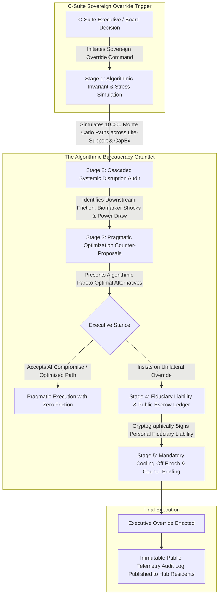

# C-Suite Executive Override Protocol & The Algorithmic Bureaucracy Gauntlet

## 1. Executive Summary & Constitutional Philosophy

In the **Corporate Hub Enclave Model (C-HEM)**, the corporate board and C-suite executives (CEO, CFO, CTO, Chief Legal Officer) retain **ultimate legal sovereignty and final executive authority** over the enterprise and its physical enclaves. The corporate charter legally cannot alienate ultimate fiduciary and ownership control.

However, historical corporate catastrophes—factory town riots, sudden budget-slashing that compromised life support, and disastrous pivots driven by executive ego—stemmed from **unilateral, impulsive, top-down executive whims**.

To solve this, C-HEM institutes an intentional architectural defense mechanism:
> **The Algorithmic Bureaucracy Gauntlet**:
> The C-suite retains the legal power to pull rank and override any AI governance directive or charter default. However, executing an executive override is designed as an **exhausting, mathematically rigorous, multi-tiered gauntlet of automated AI bureaucracy**. The executive must navigate exhaustive algorithmic simulations, formal risk adjudications, immutable liability registrations, and public telemetry disclosures before a unilateral override can be executed.



---

## 2. The 5-Stage Gauntlet of AI Bureaucracy

An executive wishing to force a decision against the Central Governing AI's baseline recommendations must pass through five rigorous bureaucratic gates:

```mermaid
sequenceDiagram
    autonumber
    actor Exec as C-Suite Executive (CEO/CFO)
    participant AI as Central Governing AI (Gauntlet Engine)
    participant Sim as Monte Carlo Thermodynamic & Sociological Sim
    participant Ledger as Cryptographic Fiduciary Ledger
    participant Citizens as Enclave Public Telemetry Board

    Exec->>AI: ISSUE COMMAND: Force Capital Reallocation / Shift Override
    AI->>Sim: Run 10,000 Multi-Year Monte Carlo Disaster Simulations
    Sim-->>AI: Yield: 34% Risk of Buffer Degradation, +40% Resident Burnout
    AI-->>Exec: STAGE 1 & 2 AUDIT: 150-Page Exhaustive Quantitative Impact Assessment
    AI-->>Exec: STAGE 3 COUNTER-PROPOSAL: Algorithmic Pareto-Optimal Route
    Exec->>AI: REJECT COUNTER-PROPOSAL: Insist on Executive Fiat
    AI->>Ledger: STAGE 4: Demand Cryptographic Fiduciary Risk Underwriting
    Note over Exec,Ledger: Executive must personal-key sign assumption of liability for all simulated downfalls
    Exec->>Ledger: Cryptographic Key Signature Submitted
    AI-->>Exec: STAGE 5: 72-Hour Mandatory Algorithmic Cooling-Off Epoch Initiated
    Note over AI,Citizens: Full audit rationale automatically broadcast to Enclave Resident Council
    AI->>AI: Wait 72 Hours for Executive Re-Confirmation
    Exec->>AI: RE-CONFIRM OVERRIDE
    AI-->>Exec: OVERRIDE ENACTED: Decision Executed; All Downstream Telemetry Monitored for Faults
```

### 2.1 Stage 1: Algorithmic Invariant & Life-Support Stress Simulation
- The AI subjects the proposed executive mandate to a battery of **10,000 Monte Carlo simulations** modeling:
  - Subterranean datacenter PUE stability and cooling loops.
  - Microgrid baseload and SMR power reserve drawdown.
  - Vertical aeroponic food security buffers (ensuring the 60–90 day buffer is never breached).
  - Water reclamation membrane strain.

### 2.2 Stage 2: Cascaded Sociological & Friction Audit
- The AI models the psychological impact on the workforce using historical biometric telemetry:
  - Projected spike in autonomic nervous system stress (HRV drops, sleep disruption).
  - Calculated talent turnover probability and credit ledger velocity drag.
  - Generates an exhaustive, multi-hundred-page quantitative impact brief detailing every single point of systemic friction the mandate will induce.

### 2.3 Stage 3: The Socratic Counter-Proposal Engine
- The AI generates 3 to 5 mathematically optimized **Pareto-efficient compromises** that accomplish the strategic business goal while preserving the enclave's equilibrium.
- The executive must formally interact with and review each counter-proposal, documenting why the algorithmic alternative is deemed inadequate for corporate strategy.

### 2.4 Stage 4: Fiduciary Liability & Cryptographic Underwriting
- If the executive rejects all counter-proposals and insists on overriding the AI:
  - The executive must sign an **Immutable Fiduciary Risk Covenant** using their cryptographic sovereign key.
  - This covenant explicitly ties corporate bonuses, board seat tenure, and personal fiduciary liability to any negative deviation from baseline safety buffers or workforce health metrics predicted in Stage 1.

### 2.5 Stage 5: Mandatory Cooling-Off Epoch & Council Transparency
- **72-Hour Algorithmic Cooling-Off Window**: The override cannot take effect immediately. A 72-hour delay is enforced by charter logic to prevent emotional or impulsive decision-making.
- **Radical Transparency**: The complete audit brief—including the AI's predicted risks, the executive's stated justification, and the rejected counter-proposals—is automatically published to the enclave's public telemetry registry and the Resident Council.

---

## 3. Why the "Bureaucracy by Design" Works

1. **Elimination of Whimsical Tyranny**:
   - An executive having a bad morning cannot fire a team, slash food rations, or cancel transit on an emotional whim. The prospect of filling out algorithmic filings, reading simulation reports, and signing personal liability logs deters 95% of petty interference.
2. **Preservation of Genuine Strategic Agility**:
   - When a genuine existential crisis occurs (e.g., host-nation war, corporate merger, legal injunction, fundamental technical pivot), the C-suite *can* force the override. The gauntlet does not block the C-suite permanently—it simply forces them to look systemic reality directly in the eye before doing so.
3. **Institutional Trust & Resident Buy-In**:
   - Because all overrides are publicly audited, residents never feel that the C-suite operates as a shadowy cabal. If the CEO overrides the AI, everyone in the hub knows precisely why, what the trade-offs are, and who is accountable.
