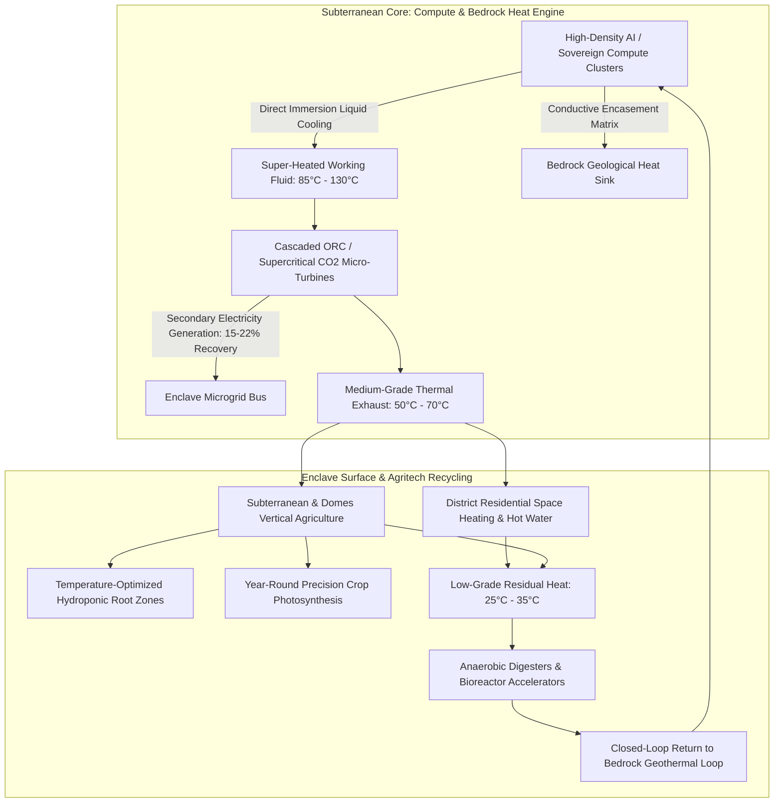

# Underground Subterranean Datacenter & Geothermal Thermodynamic Engine

## 1. Executive Summary & Foundational Engineering

The closed-loop metabolism of the **Corporate Hub Enclave Model (C-HEM)** is anchored subterraneanly:
At the enclave's bedrock foundation sits an **Underground High-Density Datacenter (U-HDC)**.

Rather than treating compute heat dissipation as an energetic waste liability (as traditional open-air surface datacenters do by expending 30–40% of their total energy on evaporative cooling towers and chillers), C-HEM converts computation into the **primary thermodynamic prime mover of the entire enclave**.

> **Thermodynamic Axiom**:
> The underground datacenter is encased in high-conductivity metallurgical/graphitic matrices, turning the surrounding geological bedrock into an infinite **geothermal heat sink**. High-grade compute exhaust drives **closed-loop Organic Rankine Cycle (ORC) / supercritical $CO_2$ micro-turbines** to co-generate secondary electricity, while lower-grade thermal cascades heat agricultural greenhouses, vertical aeroponic domes, district water, and residential quarters.

---

## 2. Structural Encasement & Geothermal Bedrock Heat Sink

### 2.1 Conductive Geological Encasement
Traditional datacenters are exposed to surface atmospheric ambient fluctuations (summer heat waves, freezing winters). The U-HDC is constructed 30 to 80 meters subterraneanly:
1. **High-Conductivity Liners**: The datacenter cavern walls are lined with a composite matrix of **copper-alloy thermal conduits, graphite-impregnated conductive shotcrete, and boron-nitride polymer seals**.
2. **Infinite Geological Heat Sinking**: The vast thermal mass of the surrounding bedrock acts as a constant-temperature thermal reservoir ($12^\circ\text{C}$ to $16^\circ\text{C}$ baseload). When compute loads spike, thermal energy bleeds directly into the lithosphere without evaporative water loss.
3. **Seismic & Physical Hardening**: Underground placement provides sovereign physical security, electromagnetic pulse (EMP) shielding, and protection against surface climate disruptions.

---

## 3. Cascaded Multi-Stage Thermodynamic Energy Recovery

Compute exhaust heat does not dissipate into the air; it cascades through a series of **staged thermal drops**:

$$\text{Stage 1 (Turbine Generation)} \longrightarrow \text{Stage 2 (Agricultural Domes)} \longrightarrow \text{Stage 3 (District Heating)} \longrightarrow \text{Stage 4 (Bioreactors)}$$

### 3.1 Stage 1: Closed-Loop Micro-Turbines (Power Co-Generation)
- High-performance compute racks utilize dielectric two-phase liquid immersion cooling or pressurized direct-to-chip microfluidics.
- Working fluids reach temperatures between **$85^\circ\text{C}$ and $130^\circ\text{C}$**.
- This fluid expands through **Organic Rankine Cycle (ORC)** micro-turbines or **supercritical $CO_2$ ($sCO_2$)** closed-loop turbines.
- **Power Regeneration**: The turbines extract **15% to 22% of the datacenter's dissipated heat back into electricity**, routing clean power directly back into the enclave’s central electrical microgrid.

### 3.2 Stage 2: Year-Round Agricultural & Greenhouse Climate Optimization
- After exiting the micro-turbines, the working fluid retains significant usable heat (**$50^\circ\text{C}$ to $70^\circ\text{C}$**).
- This fluid is piped directly into the root zones and environmental air handlers of the enclave's **Vertical Aeroponic Arrays and Agricultural Domes**:
  - **Photosynthetic Optimization**: Eliminates seasonal temperature variations; crops (greens, strawberries, legumes, dwarf grains) operate at their biological ideal ($21^\circ\text{C}$ to $24^\circ\text{C}$) 365 days a year regardless of external blizzards or freezes.
  - **Zero Heating Fuel Costs**: Food cultivation requires zero external natural gas or resistive electric heating, cutting agricultural OpEx by over 60%.

### 3.3 Stage 3: District Residential Heating & Hot Water
- Residual heat is routed through insulated municipal district heating loops into Hab-Cell pods:
  - Supplies continuous domestic hot water and floor radiant heating.
  - Eliminates individual water heaters and municipal boilers across all residential modules.

### 3.4 Stage 4: Microbial & Bioreactor Acceleration
- Low-grade effluent (**$28^\circ\text{C}$ to $38^\circ\text{C}$**) enters the enclave's anaerobic digesters and microbial wastewater treatment reactors:
  - Accelerates bacterial decomposition of organic waste.
  - Maximizes biogas methane synthesis and organic fertilizer extraction.
  - The fully depleted fluid returns to the deep bedrock cooling loop to restart the refrigeration cycle.

---

## 4. Engineering Metrics & Model Parameters

| Parameter | Traditional Open-Air Datacenter | C-HEM Subterranean Conductive Datacenter |
| :--- | :--- | :--- |
| **Cooling Method** | Evaporative towers + electric chillers | Conductive bedrock heatsink + liquid immersion |
| **Power Usage Effectiveness (PUE)** | 1.25 – 1.45 | **1.03 – 1.06** (near theoretical floor) |
| **Water Consumption for Cooling** | Millions of gallons / day | **Zero (closed-loop fluid cycle)** |
| **Heat Recovery Efficiency** | 0% (dumped into the atmosphere) | **82% – 88% cascaded recycling** |
| **Electricity Regeneration via Turbines**| 0% | **15% – 22% of thermal wattage recovered** |
| **Heating Cost for Enclave Agriculture** | High market electric/gas rates | **$0.00 (100% compute byproduct)** |

---

## 5. Systemic Strategic Impact

This subterranean thermodynamic coupling transforms the datacenter from an expensive overhead center into the **literal beating thermal and computational heart of the enclave**:
1. **Resilience**: The enclave can survive extended sub-zero external winters or surface grid blackouts completely insulated from outside conditions.
2. **Food Autonomy**: The continuous thermal cascade guarantees unbroken vertical agricultural crop yields, directly securing the unconditional Tier 0 nutritional floor.
3. **Negative Carbon / Zero Waste Metabolism**: Compute emissions directly generate the calories that feed the workforce programming the servers.
