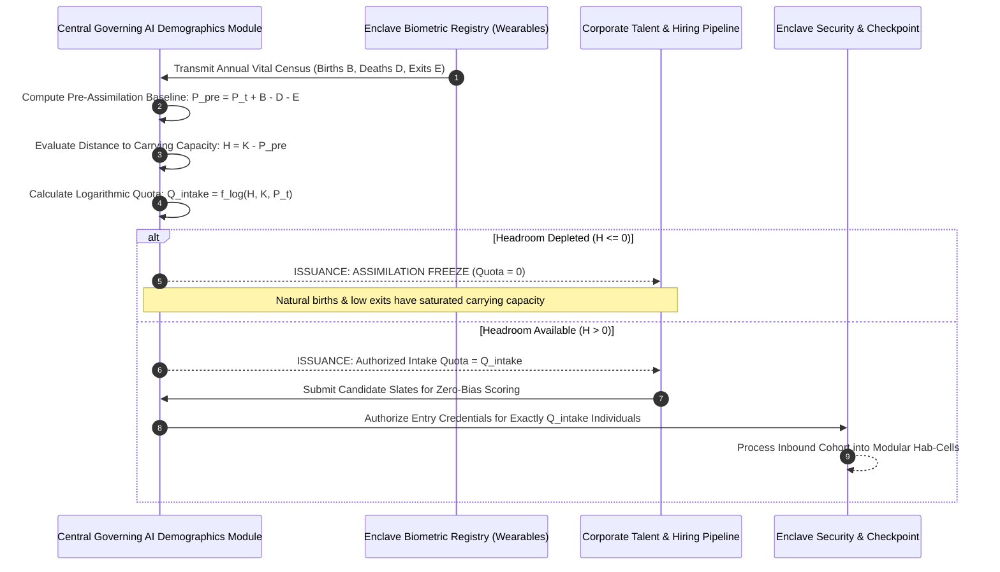

# Logarithmic Demographics & Pre-Assimilation Carrying Capacity Engine

## 1. Executive Summary & Demographic Philosophy

Uncontrolled exponential population growth is a fatal vulnerability for self-contained, closed-loop ecosystems. Because spatial footprints, vertical agricultural yields, subterranean datacenter thermal dissipation, and water recycling loops operate within defined physical capacities, the enclave cannot permit unrestricted demographic expansion.

The **Corporate Hub Enclave Model (C-HEM)** implements a **Logarithmic Carrying Capacity Governor**:
> **Axiom of Sustainable Carrying Capacity**:
> The enclave population is bounded by an asymptotic carrying capacity ($K$). As total population approaches $K$, growth velocity logarithmically dampens toward zero. To prevent overshooting the physical life-support envelope, **all internal vital dynamics (births, natural attrition/deaths, and contract separations) are calculated before any new candidates are approved for external assimilation**.

```mermaid
graph TD
    subgraph Annual Census & Vital Dynamic Accounting
        PopCurrent[Current Enclave Population: P_t]
        Births[Calculated Projected Births: B_t]
        Deaths[Calculated Projected Deaths: D_t]
        Exits[Calculated Separations & Exits: E_t]
        
        PopCurrent --> NetVital[Net Internal Vital Delta: ΔV = B_t - (D_t + E_t)]
        Births --> NetVital
        Deaths --> NetVital
        Exits --> NetVital
    end

    subgraph Logarithmic Governor & Carrying Capacity Engine
        K[Maximum Physical Carrying Capacity: K]
        NetVital --> PreAssimilated[Pre-Assimilation Population: P_pre = P_t + ΔV]
        K --> Headroom[Available Carrying Headroom: H = K - P_pre]
        
        Headroom --> LogGrowth[Logarithmic Intake Function: A_t = r * P_t * ln(1 + H / K)]
    end

    subgraph External Assimilation Gate
        LogGrowth --> IntakeQuota[Permissible New Assimilation Quota: Q_intake]
        Candidates[External Candidate Pipeline / Hiring Queue] --> Gatekeeper[Zero-Bias AI Assimilation Gate]
        IntakeQuota --> Gatekeeper
        Gatekeeper --> NewCitizens[Assimilated Workers & Dependents: <= Q_intake]
        NewCitizens --> NextCensus[Next Year Population: P_t+1 <= K]
    end
```

---

## 2. Mathematical Formulation: The Logarithmic Governor

Traditional unconstrained systems grow exponentially ($P_{t+1} = P_t(1 + r)$), quickly exceeding modular capacity and triggering resource crises. 

C-HEM models growth using a **logarithmic/logistic dampened intake curve**:

### 2.1 Pre-Assimilation Balance Sheet Equation
At the conclusion of each demographic cycle (e.g., annual epoch), the Central Governing AI evaluates internal population movement before admitting a single new individual:

$$P_{\text{pre}, t} = P_t + B_t - D_t - E_t$$

Where:
- $P_t$: Existing population base.
- $B_t$: Documented births within the enclave ($B_t = P_t \times b_{\text{rate}}$).
- $D_t$: Documented natural mortality / deaths ($D_t = P_t \times d_{\text{rate}}$).
- $E_t$: Contract separations, voluntary resignations, and perimeter evictions.

### 2.2 Available Carrying Capacity Headroom
Let $K$ represent the hard carrying capacity dictated by current operational Hab-Cells, vertical farm acreage, water bioreactor volume, and microgrid baseload. The available headroom ($H_t$) is:

$$H_t = \max(0, K - P_{\text{pre}, t})$$

### 2.3 Logarithmic Assimilation Quota ($Q_{\text{intake}}$)
New external candidate assimilation ($Q_{\text{intake}}$) is strictly bounded by the logarithmic deceleration curve:

$$Q_{\text{intake}, t} = \min\left( H_t, \; \left\lfloor r \cdot P_t \cdot \ln\left(1 + \frac{H_t}{K}\right) \right\rfloor \right)$$

Where:
- $r$: Baseline intake velocity parameter.
- $\ln\left(1 + \frac{H_t}{K}\right)$: The logarithmic dampener.
  - When the enclave is young and sparsely populated ($H_t \approx K$), $\ln(1 + 1) = \ln(2) \approx 0.693$, permitting rapid initial staffing.
  - As the population approaches carrying capacity ($H_t \to 0$), $\ln(1 + \epsilon) \to 0$, causing permissible new assimilation to smoothly converge to zero.
  - If unexpected births or reduced exits push $P_{\text{pre}, t} \ge K$, $H_t = 0 \implies Q_{\text{intake}} = 0$, enforcing an absolute freeze on external transfers.

---

## 3. Pre-Assimilation Accounting Workflow



---

## 4. Policy, Family Dynamics & Social Stability

### 4.1 Family Planning & Pediatric Care
- Enclave policy supports family formation through comprehensive pediatric care, automated childcare, and family-sized living suites.
- However, because births ($B_t$) directly consume available carrying capacity headroom ($H_t$), a rising birth rate automatically contracts the external hiring quota ($Q_{\text{intake}}$).
- **Economic Equilibrium**: The company trades off external adult hiring velocity against organic, native-born demographic continuity, ensuring that children born in the enclave never strain life-support reserves.

### 4.2 Natural Mortality & Dignified End-of-Life
- While the enclave population skews working-age, long-term multi-decade models account for natural deaths ($D_t$) and retirement cohorts.
- Natural deaths and voluntary post-retirement external relocations return carrying capacity to the pool, unlocking new slots for next-generation talent.

### 4.3 Absolute Anti-Overshoot Guarantee
By calculating births and deaths *prior* to approving candidate assimilation offers, the Central Governing AI mathematically guarantees that the enclave will never suffer from famine, water rationing, brownouts, or housing shortages caused by demographic overpopulation.
