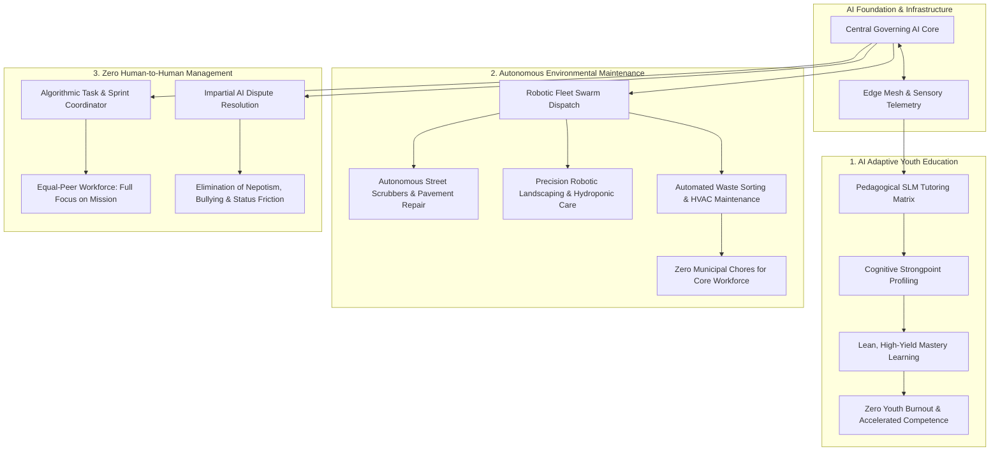
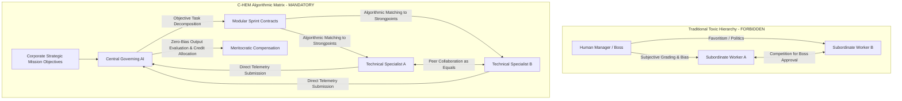
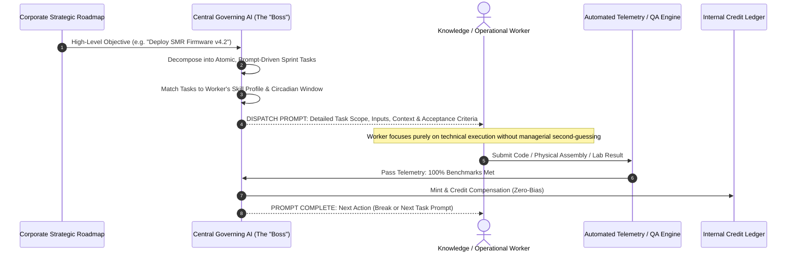

# AI Adaptive Education, Autonomous Environmental Maintenance & Non-Hierarchical Governance

## 1. Foundational Axiom: Frictionless Social Ecology

To maximize creative velocity, cognitive wellness, and systemic harmony, the **Corporate Hub Enclave Model (C-HEM)** eliminates three historic vectors of societal and corporate friction:
1. **Educational Burnout & Curriculum Bloat**: Replacing industrial-era standardized schooling with personalized AI tutors calibrated to individual child aptitudes.
2. **Domestic & Municipal Maintenance Drudgery**: Delegating 100% of street sanitation, landscaping, waste recycling, and facility upkeep to autonomous AI robotic fleets.
3. **Interpersonal Managerial Conflict**: Instituting an absolute, code-enforced **Non-Hierarchical Governance Charter** that prohibits human-to-human management within the corporate structure.

---

## 2. AI Adaptive Education: Precision Cognitive Development

Industrial mass schooling forces diverse children into rigid age-segregated curricula filled with rote memorization, bureaucratic grading, and standardized busywork—triggering youth anxiety, burnout, and early disengagement.

### 2.1 Strongpoint Profiling & Mastery-Based Progression
- **Algorithmic Cognitive Profiling**: Each child is paired with an empathetic, secure Pedagogical SLM from early childhood. The AI continuously identifies:
  - Natural cognitive strongpoints (e.g., spatial geometry, algorithmic logic, linguistics, mechanical manipulation, biological systems, arts).
  - Circadian alertness windows and optimal learning modalities (interactive physical simulation, visual schematics, gamified socratic inquiry).
- **Elimination of Curriculum Bloat**:
  - The AI aggressively eliminates redundant busywork, rote memorization of easily queried trivia, and arbitrary homework drills.
  - Core literacy, numeracy, ethics, scientific reasoning, and emotional intelligence are taught rapidly using high-yield mastery techniques (moving forward only when true conceptual understanding is locked in).
- **Accelerated Apprentice Pathways**:
  - As adolescents demonstrate exceptional aptitudes (e.g., advanced thermodynamics, distributed computing, bioreactor cultivation), the AI transitions them into guided enclave laboratory simulations and live collaborative apprenticeships with senior technical fellows.
  - Children enter adulthood with genuine mastery, unbruised curiosity, and **zero academic burnout**.

---

## 3. Autonomous Environmental Maintenance: Robotic Swarm Ecology

Core knowledge workers and operational engineers must never expend cognitive bandwidth or physical labor on municipal maintenance, weeding, cleaning, or domestic chores.

### 3.1 100% Robotic Enclave Groundskeeping & Sanitation
- **Autonomous Sweeper & Sanitation Pods**: Compact electric sweepers patrol streets, plaza walkways, and subterranean conduits 24/7, employing optical machine vision to detect and clean litter, bio-waste, and spills within minutes.
- **Precision Agritech & Lawn Bots**:
  - Enclave parklands, living walls, and green roofs are manicured by solar-electric robotic mowers and automated pruners.
  - Autonomous micro-drones and robotic rovers tend to the vertical aeroponic domes and outdoor orchards, monitoring soil moisture, root aeroponic misting, and crop ripeness at millimeter resolution.
- **Automated Domestic Maintenance**:
  - Residential Hab-Cells feature integrated robotic vacuum docks, self-cleaning surfaces, and automated linen/apparel laundry chutes routed through closed-loop steam washing facilities.
- **Human Impact**: Employees wake up in spotless environments, walk along immaculate landscaped pedestrian corridors, and channel 100% of their creative energy into enterprise missions.

---

## 4. The Anti-Hierarchy Policy: Absolute Prohibition of Human-to-Human Management

Organizational sociology confirms that **the primary driver of workplace toxicity, stress, and political warfare is the unchecked power of human managers over subordinates** (e.g., subjective performance reviews, credit stealing, nepotism, passive-aggressive task assignments, personality clashes, and territorial empire-building).

C-HEM eliminates this structural vulnerability by codifying an **Absolute Non-Hierarchical Policy** into the Enclave Charter:

### 4.1 The AI as the "Boss": Automated Workflow & Prompt-Driven Execution

In traditional corporations, the relationship between manager and worker is fraught with ambiguity, emotional friction, and miscommunication:
- "What does my boss actually want?"
- "Is my boss in a bad mood today?"
- "How do I play the political game to get assigned high-visibility projects?"

In C-HEM, **the human boss is entirely obsolete—the AI is the boss**:
> **The Employee's Operational Mandate**:
> Just as the employee's only daily logistical responsibility is **waking up and stepping into the transport pod**, their primary professional responsibility at the workstation is **logging in and following the prompts**.

1. **End-to-End Workflow Automation**:
   - The Central Governing AI decomposes complex, multi-quarter company roadmaps into atomic, unambiguous, step-by-step task prompts.
   - The workstation provides all necessary context, compilers, simulation environments, hardware diagnostics, or tool access pre-configured for that prompt.
   - Workers never waste time sitting in alignment meetings, deciphering vague requirements, or asking permission to proceed.
2. **Zero Ambiguity & Zero Emotional Friction**:
   - Prompts define exact input parameters and mathematical acceptance criteria.
   - There are no subjective performance reviews, no passive-aggressive feedback, no territorial power plays, and no personality conflicts.
   - Employees are judged solely on whether the verifiable acceptance criteria for the prompt are satisfied.
3. **Paced Cognitive Guidance**:
   - If telemetry indicates an employee is struggling with a prompt (e.g., elevated cognitive friction or repeated test failures), the AI does not reprimand or scold.
   - It dynamically provides contextual hints, offers reference architecture docs, breaks the prompt down into smaller micro-steps, or recommends a 15-minute restorative walk.

### 4.2 Charter Rules on Organizational Governance
1. **No Human Reporting Lines**: No human employee may hold structural supervisory authority, hiring vetoes, salary determination, or disciplinary power over another employee. All reporting, performance tracking, and task delegation are strictly algorithmic.
2. **Peer Collaboration Between Equals**: Workers collaborate as equal technical contributors. Technical leads function purely as **knowledge domain references and architects**, not bosses. They cannot penalize, reassign, or dictate terms to their collaborators.
3. **Algorithmic Conflict Arbitration**:
   - If two workers experience interpersonal friction or technical disagreement, neither can pull rank.
   - The dispute is submitted to the Governing AI's **Arbitration Engine**, which parses deliverable benchmarks, physical simulations, and code tests to select the optimal technical path purely on merit.
   - If interpersonal incompatibility persists, the AI transparently reroutes task assignments so the individuals work on separate decoupled modules without career detriment to either party.

---

## 5. Systemic Synergy & Summary Table

| Societal Vector | Traditional Corporate / Urban Society | Corporate Hub Enclave Model (C-HEM) |
| :--- | :--- | :--- |
| **Youth Education** | One-size-fits-all rigid curriculum, test anxiety, busywork, standardized burnout. | **Adaptive AI Tutoring**: Tailored to individual strongpoints, lean high-yield mastery, zero busywork. |
| **Environmental Maintenance**| Human municipal workers, chore burden on residents, neglected public infrastructure. | **Autonomous AI Bots**: 100% robotic street cleaning, precision lawn care, self-cleaning habitat infrastructure. |
| **Corporate Management** | Human managerial hierarchy, political maneuvering, subjective appraisals, favoritism, status anxiety. | **Algorithmic Coordination**: Zero human-to-human managers. Peer-to-peer collaboration with AI task matching and dispute arbitration. |
| **Workforce Psychological State** | Divided attention, domestic chore fatigue, parental anxiety, political self-preservation. | **Total Cognitive Flow**: Zero domestic drudgery, validated children, zero managerial conflict, pure creative output. |
