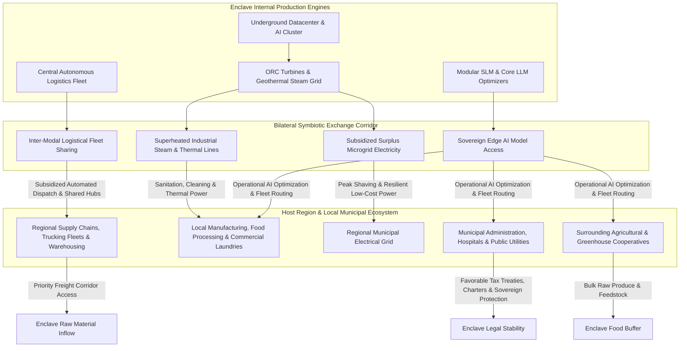
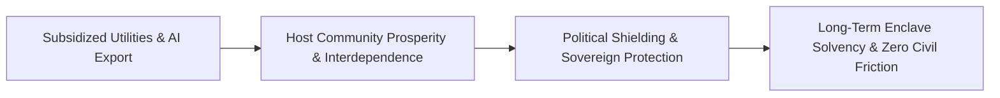

# Regional Bilateral Symbiosis & External Utility Exchange

## 1. System Philosophy: The Non-Parasitic Enclave

A fundamental existential risk for any corporate enclave is political and social hostility from host municipalities, regional populations, and surrounding local enterprises. If an enclave operates purely as a fortified, extractive island, host governments face public pressure to impose punitive taxes, block supply corridors, or revoke sovereign charters.

The **Corporate Hub Enclave Model (C-HEM)** neutralizes external friction through **Regional Bilateral Symbiosis**:
> Rather than existing as an isolated, parasitic bubble, the enclave partners with and subsidizes existing local distribution networks. The corporation exports its immense subterranean thermodynamic surplus, computational intelligence, and logistical automation to surrounding communities at subsidized rates—transforming the enclave into an indispensable regional utility and economic anchor.

---

## 2. Core Subsidized External Utility Streams

### 2.1 Industrial Steam & High-Temperature Fluid (Sanitation & Cleaning)
- **Production Origin**: Direct thermodynamic exhaust from the subterranean datacenter's secondary heat exchangers and geothermal loops produces superheated industrial steam ($110^\circ\text{C}$ to $140^\circ\text{C}$) and high-temperature pressurized hot water.
- **Regional Deployment**:
  - Piped via insulated utility conduits directly to local industrial parks, food processing plants, beverage bottlers, commercial laundries, and municipal wastewater treatment facilities.
  - **Industrial Cleaning & Sterilization**: Provides zero-emission, zero-boiler sanitation steam to local businesses at a 40–60% discount compared to natural gas boilers.
  - **Cold-Weather Municipal Melting**: Channels residual steam beneath municipal roads, bridge decks, and runways in adjacent townships to prevent winter icing without corrosive road salts.

### 2.2 Subsidized Electrical Microgrid Integration
- **Grid Stabilization & Peak Shaving**:
  - The enclave's dedicated SMR/microgrid coupled with ORC turbine regeneration yields continuous baseload power with high surplus margins.
  - During regional grid stress, extreme weather events, or peak utility pricing, the enclave exports low-cost electricity to surrounding residential communities and hospitals.
  - Acts as a "Black-Start" anchor: If the regional municipal grid collapses during an external storm, the enclave microgrid can jump-start local substations.

### 2.3 Shared Logistics Optimization & Fleet Fleet Electrification
- **Joint Logistics Corridors**:
  - Rather than competing with local trucking companies, the corporation establishes **shared multimodal distribution hubs** at the enclave perimeter.
  - Local freight carries raw bulk goods to the enclave perimeter hub; the enclave's automated electric robotic fleets handle local last-mile distribution and high-density sorting.
  - The enclave subsidizes electric fleet charging infrastructure and automated maintenance depots for local transport partners.

### 2.4 Sovereign Edge AI Access for Regional Optimization
- **Enterprise-Grade AI for Municipal & Small Business Partners**:
  - Local businesses, farmers, clinics, and municipal agencies receive free or heavily subsidized API access to fine-tuned **Modular SLMs (Small Language Models)** running on the enclave's edge nodes.
  - **Agricultural Optimization**: Soil moisture prediction, automated drone irrigation scheduling, and micro-climate frost alerts for surrounding farms.
  - **Supply-Chain & Route Optimization**: Small local trucking operations and regional grocers leverage the enclave's routing algorithms to slash fuel burn by 25–35%.
  - **Civic & Healthcare Administration**: Local hospitals and clinics use triage SLMs to streamline intake and automate administrative paperwork.

---

## 3. Socio-Political & Economic Return for the Corporation

1. **Host-State Bilateral Charters (Regulatory Armor)**:
   - By lowering municipal energy bills, cutting industrial carbon emissions, and providing free AI modernization to local businesses, the enclave transforms from a perceived "corporate threat" into a vital public utility provider.
   - Host governments grant long-term tax stabilization pacts, zoning autonomy, and special economic zone (SEZ) charters.
2. **Resource Inflow Prioritization**:
   - Local agricultural co-ops and logistics distributors prioritize the enclave's buffer warehouses during macro crises because the enclave is their primary supplier of free steam, low-cost power, and fleet intelligence.
3. **External Goodwill & Talent Pipeline**:
   - Surrounding populations benefit directly from enclave technology without having to reside inside, creating a healthy regional talent pool and eliminating local anti-corporate backlash.
