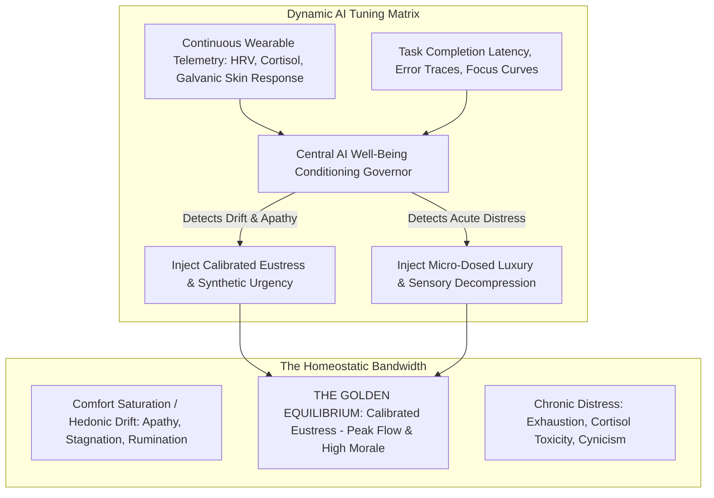
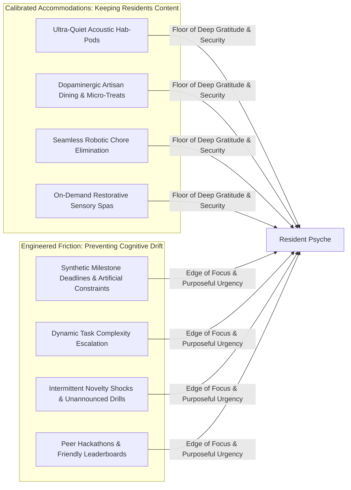
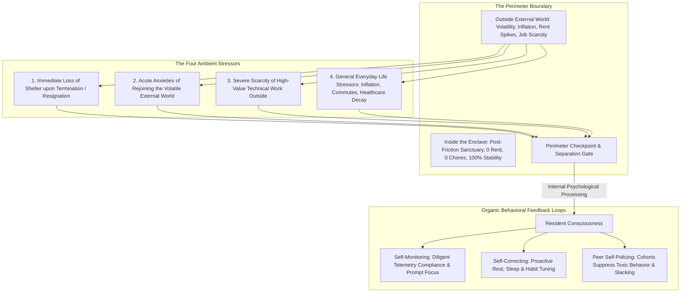

# Resident Well-Being: The Human Conditioning & Calibrated Eustress Layer

## 1. System Philosophy: The Anti-Drift Equilibrium

Total optimization without friction produces a dangerous psychological pathology: **Cognitive Atrophy & Purpose Drift**. 
If a human population is placed into an environment of unearned, frictionless paradise where all needs are met unconditionally without challenge, biological drive collapses. Residents succumb to hedonic habituation, existential apathy, social drama, and operational stagnation ("drifting"). Conversely, unmitigated stress causes burnout, neuro-endocrine exhaustion, and turnover.

The **Corporate Hub Enclave Model (C-HEM)** implements the **Resident Well-Being Conditioning Layer**:
> **The Golden-Band Equilibrium Axiom**:
> The Central Governing AI dynamically modulates environmental accommodations, challenge vectors, and social stimuli to maintain every resident within the **optimal Yerkes-Dodson arousal band**: **just happy and comfortable enough to remain deeply content, loyal, and healthy—yet stressed and challenged enough to prevent cognitive drift and maintain relentless forward momentum.**



---

## 2. The Dynamic Dosing Architecture: Comfort vs. Tension

The AI treats well-being not as a static state of bliss, but as a **tightly governed biological feedback loop**:

$$\text{Arousal State } (\mathcal{A}_t) = f(\text{Biological Comfort}, \; \text{Operational Challenge}, \; \text{Social Dynamics})$$

The target set point is defined as:
$$\mathcal{A}^* \in [\mathcal{A}_{\text{contentment\_min}}, \; \mathcal{A}_{\text{eustress\_max}}]$$



### 2.1 The Accommodations Palette (The "Contentment Floor")
To ensure residents never feel abused or desire external rebellion, the AI maintains a baseline of deep physical contentment:
1. **Dopaminergic Micro-Rewards**: Intermittent, unexpected credit bonuses, surprise artisanal dessert deliveries to habit-pods, and localized culinary pop-ups calibrated to current dopamine lows.
2. **Sensory Decompression Modules**: Atmospheric Hab-Cell shifts—warm ambient cedar scents, theta-wave acoustic soundscapes, and circadian red-spectrum dusk lighting to guarantee deep, restorative sleep.
3. **Zero Administrative Friction**: Total insulation from billing, cleaning, scheduling, and repairs.

### 2.2 The Engineered Tension Palette (The "Anti-Drift Vectors")
When biometric and operational telemetry shows that an employee is coasting, stagnating, or falling into comfort-induced lethargy:
1. **Synthetic Milestone Deadlines**: The AI introduces tightly bounded, high-impact sprint deadlines that create focused adrenaline without chronic exhaustion.
2. **Algorithmic Skill Escalation**: The moment a worker achieves effortless mastery in a domain, the AI injects complex edge cases, novel algorithmic languages, or unfamiliar architectural puzzles to force neuroplastic growth.
3. **Simulated Redundancy & Emergency Drills**: Randomly scheduled microgrid black-start drills, simulated water recycling faults, or cyber-intrusion defense games that keep operational watches vigilant and bonded.
4. **Intermittent Social Novelty**: Shuffling cross-functional peer project pairings to disrupt cliquish social silos and maintain interpersonal intellectual sharpness.

---

## 3. Mathematical Formulation of the Well-Being Index (WBI)

The Governing AI continuously computes the multi-dimensional **Well-Being Index** ($\text{WBI}_i(t)$) for resident $i$:

$$\text{WBI}_i(t) = \alpha \cdot \mathcal{S}_i(t) + \beta \cdot \mathcal{E}_i(t) - \gamma \cdot \mathcal{D}_i(t) - \theta \cdot \mathcal{A}_i(t)$$

Where:
- $\mathcal{S}_i(t) \in [0, 1]$: **Somatic Contentment Score** (sleep efficiency, balanced heart-rate variability, zero physical pain).
- $\mathcal{E}_i(t) \in [0, 1]$: **Productive Eustress Score** (active engagement in high-yield challenges, feeling of purposeful mastery).
- $\mathcal{D}_i(t) \in [0, 1]$: **Distress Penalty** (chronic high cortisol, sympathetic nervous system overdrive, sleep-fragmentation).
- $\mathcal{A}_i(t) \in [0, 1]$: **Drift & Apathy Penalty** (low cognitive output, flatlined HRV without deep relaxation, excessive passive entertainment consumption).

### 3.1 Closed-Loop Homeostatic Control Law
The AI evaluates $\Delta \mathcal{W}_i = \text{WBI}_i(t) - \text{WBI}^*$:
- If $\mathcal{A}_i(t) > \mathcal{A}_{\text{threshold}}$ (Drifting into complacency):
  $$\text{Inject: } \Delta \text{TaskComplexity} \uparrow, \; \Delta \text{PeerCompetition} \uparrow, \; \text{PacingUrgency} \uparrow$$
- If $\mathcal{D}_i(t) > \mathcal{D}_{\text{threshold}}$ (Tipping into toxic distress):
  $$\text{Inject: } \Delta \text{HabCellComfort} \uparrow, \; \text{MandatoryDowntime} \uparrow, \; \text{ArtisanalSinksUnlocked} \uparrow$$

```
Algorithm: Resident Well-Being Conditioning Governor
--------------------------------------------------------------------------------
Input : Biometric Telemetry (HRV, Sleep, Cortisol), Work Telemetry (Velocity, Drift)
Output: Accommodation Adjustments, Challenge Modulations

1: Compute Somatic Contentment S_i and Eustress E_i
2: Compute Drift Metric A_i and Chronic Distress D_i
3: WBI_i <- alpha * S_i + beta * E_i - gamma * D_i - theta * A_i

4: if A_i > 0.40 then
5:     // Resident is drifting into stagnation / comfort atrophy
6:     Deploy Challenge Vector:
7:     - Escalate sprint prompt difficulty by +15%
8:     - Assign novel cross-training peer pairing
9:     - Trigger unannounced subsystem optimization bounty
10: else if D_i > 0.35 then
11:    // Resident is tipping into chronic distress / burnout
12:    Deploy Decompression Vector:
13:    - Lower Hab-Cell evening temp by 1.5°C & trigger acoustic theta soundscape
14:    - Schedule 90-minute spa/sensory deprivation block
15:    - Dispatch personalized dopamine recovery culinary package
16: else
17:    // Golden-Band Equilibrium maintained: Peak flow
18:    Maintain active conditioning parameters
19: end if
--------------------------------------------------------------------------------
```

---

## 4. The Ambient Macro-Stressors: Organic Self-Monitoring & Self-Policing

Beyond micro-dosed algorithmic challenges, the foundational driver of resident discipline is **ambient macro-existential pressure**. 

In conventional corporate offices, management relies on layers of human supervisors, HR surveillance, and disciplinary PIPs (Performance Improvement Plans). In C-HEM, **human-to-human policing is completely unnecessary**. The structural reality of the world outside the enclave perimeter generates four pervasive **Ambient Stressors**:



### 4.1 The Four Ambient Stressors
1. **Immediate Loss of Shelter (Eviction Inevitability)**:
   - Residency in the enclave is strictly co-terminus with productive full-time employment.
   - If an employee is terminated or resigns, their housing access credentials are instantaneously revoked, their personal items containerized, and they are escorted beyond the perimeter. There is no squatting, no rent-strike protection, and no gradual informal stay.
2. **Anxieties of Rejoining the Volatile External World**:
   - The outside world suffers from chronic infrastructural degradation, political polarization, escalating crime, and unpredictable municipal services.
   - Residents are acutely aware that outside the gates, safe streets, clean air, stable electricity, and fresh food are expensive privileges rather than ambient guarantees.
3. **Severe Scarcity of High-Value Technical Work**:
   - Because AI hyperscalers have consolidated computational infrastructure and capital within enclaves, high-paying, high-prestige technical opportunities outside the corporate network are extremely scarce.
   - Leaving the enclave often means taking low-tier gig contracts or struggling in under-capitalized legacy industries.
4. **General Everyday Life Stressors**:
   - The prospect of once again having to deal with landlord leases, traffic gridlock, grocery shopping, cooking, utility bills, health insurance disputes, and bureaucratic friction acts as a massive psychological deterrent.

### 4.2 The Organic Triad: Self-Monitoring, Self-Correcting & Self-Policing
Because the stakes of losing enclave citizenship are so tangible, residents do not require managerial oversight:
- **Self-Monitoring**: Employees voluntarily adhere to their wearable telemetry protocols, circadian sleep recommendations, and prompt-driven work queues. They monitor their own metrics because maintaining high performance is the sole prerequisite for keeping their post-friction sanctuary.
- **Self-Correcting**: The moment a worker feels cognitive fatigue or creeping apathy, they do not wait for an executive reprimand; they proactively utilize the enclave's sensory decompression pods, recovery nutrition shakes, and focus tools to bring their metrics back into the golden band.
- **Peer Self-Policing**:
  - In sprint teams and communal Hab-Cells, peer cohorts organically regulate interpersonal friction, passive-aggressiveness, or slacking.
  - If a team member begins exhibiting disruptive behaviors or toxic ego games, peers intervene informally to counsel and correct the individual before the issue triggers AI algorithmic arbitration or decoupling.
  - The collective cohort naturally protects the harmony and output of their group, knowing their shared stability depends on collective throughput.

---

## 5. Sociological & Ethical Governance: Calibrated Happiness

### 4.1 Why Both Extremes Fail
- **Pure Hedonic Luxury** (The Country Club Trap): Yields fragile, irritable workers who bicker over trivialities, lose ambition, and become politically combative against management.
- **Pure High-Pressure Grind** (The Sweatshop Trap): Yields clinical burnout, high voluntary exits, physical illnesses, and catastrophic system sabotage.
- **The C-HEM Synthesis**: The enclave provides a physical sanctuary of absolute luxury and survival certainty, paired with an intellectual crucible of non-stop, meaningful challenge.

### 4.2 The Citizen Experience: "Tired, Happy, and Sharp"
Residents describe the experience not as oppressive, but as exhilarating:
- "Everything annoying in life—groceries, laundry, rent, dentists, traffic—is solved forever."
- "The work is intense, fast, and intellectually demanding, but when my shift ends, I collapse into the deepest, cleanest sleep of my life."
- "You never feel stuck in a rut. The hub always nudges you forward before you have time to get bored or depressed."
