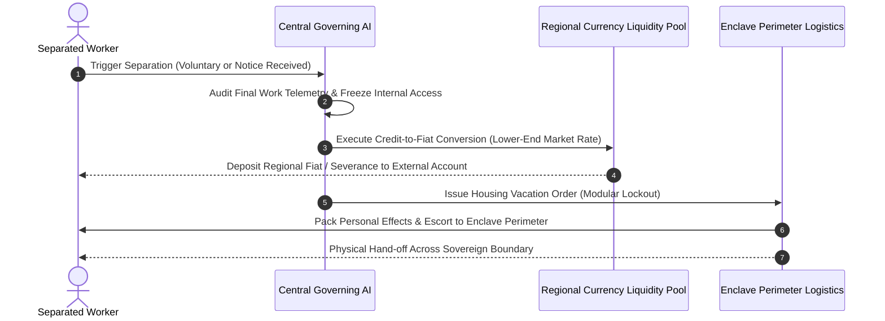

# Separation & Exit Protocol Specification

## 1. Executive Summary: The Perimeter & Termination Boundary

A critical structural design constraint of the **Corporate Hub Enclave Model (C-HEM)** is maintaining strict modularity and boundary enforcement. The enclave cannot sustain non-contributing individuals, nor can it trap workers against their will.

The **Separation & Exit Protocol** establishes the formal off-boarding procedure when an employment contract ends—whether through:
1. **Voluntary Separation** (worker resigns or seeks external life).
2. **Involuntary Termination** (poor performance, disciplinary violation, or corporate restructuring).

---

## 2. Core Protocol Rules

### 2.1 Credit-to-Fiat Conversion at the Lower-End Market Rate
- **Conversion Principle**: Internal enclave credits ($\mathcal{C}$) are non-inflationary and pegged to internal goods and services. Upon exit, accumulated liquid credits are converted to the **official legal tender / fiat currency** of the host geographic region.
- **Lower-End Market Valuation ($R_{\text{exit}}$)**:
  - To prevent speculative arbitrage (workers earning credits in a high-efficiency closed loop and extracting outsized external fiat), conversion is benchmarked at the **lower bound of current market purchasing power parity (PPP)**:
    $$\text{Fiat Payout} = \mathcal{C}_{\text{balance}} \times R_{\text{exit}}$$
    where $R_{\text{exit}} = \min(R_{\text{market\_low}}, R_{\text{pegged\_floor}})$.
  - Any non-vested or illiquid bonuses are burned upon termination.

### 2.2 Housing Revocation & Perimeter Escort
- **Zero Squatting / Instant Eviction**:
  - Enclave housing is strictly tied to active citizenship and productive inputs.
  - Upon formal separation, the physical unit's digital access credentials are decommissioned.
  - The corporate hub's automated facility service packs the individual's personal belongings into standard logistics containers.
- **Perimeter Escort**:
  - The former employee is escorted by enclave transit and security to the external municipal perimeter checkpoint.
  - Once across the boundary threshold, the individual transitions entirely back into the external host state's jurisdiction.

### 2.3 Severance & Standard Unemployment Pay
- **Discretionary Corporate Severance**:
  - The corporation may offer an additional fiat severance lump sum for honorable voluntary exits or high-tenure contributors.
- **Statutory Regional Unemployment Standard**:
  - For standard or involuntary separations, the baseline external social safety net applies:
    $$\text{Severance Package} = \text{External Standard Unemployment Equivalent} + \text{Converted Liquid Credits}$$
  - The corporation guarantees that severance satisfies or matches the host jurisdiction's standard unemployment wage floor, ensuring legal compliance with regional labor treaties without extending enclave residency.

---

## 3. Macroeconomic & Enclave Stability Dynamics

### 3.1 Deterrence of Parasitic Infiltration
Clear eviction and lower-end conversion prevent "enclave freeloading"—individuals cannot move into the hub solely to enjoy free Tier 0 food and housing and subsequently cash out at top-market rates without sustained work inputs.

### 3.2 Corporate Liquidity Reserves
The enterprise maintains an **External Fiat Conversion Reserve (EFCR)** funded by global IP exports to fulfill conversion demands during attrition spikes, without destabilizing internal operations.
