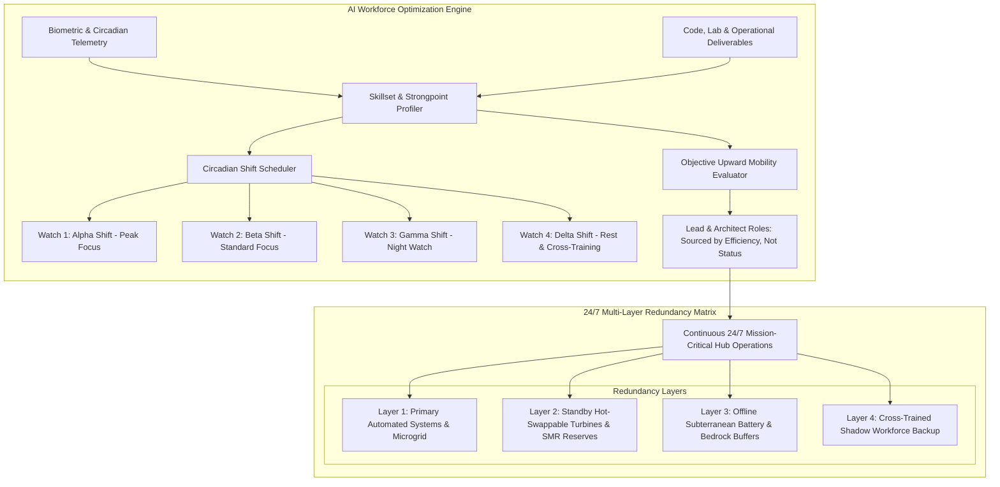
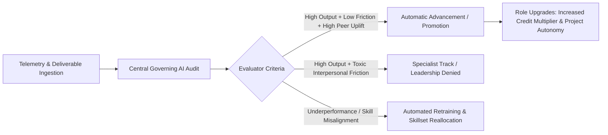

# Workforce Allocation, AI Upward Mobility & 24/7 Multi-Layer Redundancy

## 1. Foundational Architecture: Full-Time Employment & Pure Meritocracy

Traditional corporate structures suffer from severe agency friction: promotions are frequently dictated by organizational politics, executive favoritism, social charisma, and tenure length rather than operational capability. Furthermore, fragmented contractor classes create resentment and operational vulnerability.

In the **Corporate Hub Enclave Model (C-HEM)**:
1. **Universal Full-Time Status**: Every working resident within the enclave is a full-time employee with comprehensive Tier 0 guarantees, full internal credit earnings, and direct enterprise equity alignment. There are no disenfranchised secondary tiers.
2. **AI Skillset & Strongpoint Shift Optimization**: Shift schedules, project placements, and operational rotations are configured algorithmically based on objective skill assessments, cognitive profiles, and circadian biometric peak-performance windows.
3. **Objective Upward Mobility**: Advancement into senior architecture, supervisory oversight, and strategic lead roles is evaluated and awarded by the Central Governing AI. Promotion tracks are calibrated purely for **systemic efficiency and throughput**, permanently eliminating corporate status games and political posturing.
4. **24/7 Continuous Operation with Multi-Layer Redundancy**: The enclave operates continuously across 24 hours, supported by multi-watch workforce schedules and $N+2$ to $N+3$ physical, computational, and life-support redundancies.

---

## 2. Shift Allocation by Skillset, Strongpoints & Circadian Rhythms

Rather than forcing the entire workforce into arbitrary 9-to-5 schedules that clash with individual biological chronotypes and cause traffic bottlenecks:
- **Circadian Optimization**: Wearable biometric telemetry maps each employee’s natural chronotype (morning larks vs. night owls, deep focus peaks, and cognitive fatigue thresholds).
- **Skillset & Strongpoint Matching**:
  - Deep-reasoning systems architects and research engineers are placed on uninterrupted flow blocks during their measured maximum neuro-cognitive focus windows.
  - Operations, physical plant monitoring, and infrastructure technicians rotate across balanced watches ensuring alert, vigilant supervisory coverage around the clock.
- **Continuous Load Balancing**:
  - Four overlapping 6-hour or three 8-hour watches maintain seamless 24/7 hub continuity without overworking any individual.
  - The AI modulates shift duration dynamically: if autonomic stress indicators rise, the shift length contracts and automated pod transit is dispatched to return the worker to their Hab-Cell.

---

## 3. Objective AI-Assessed Upward Mobility

### 3.1 Eliminating Corporate Bias
Traditional performance appraisals are infected by recency bias, political alignment, and personal rapport with department managers. Under C-HEM, **upward mobility is managed by the Central Governing AI**:

$$\text{Mobility Score} (\mathcal{M}) = \frac{\text{Verified Deliverable Throughput} \times \text{Quality Index} + \text{Civic Mentorship Impact}}{\text{Error Rate} + \text{Systemic Friction Created}}$$

### 3.2 Efficiency Over Status
- **No Status Bloat**: Titles do not exist to confer personal power, prestige, or administrative vetoes over peers. Roles exist purely as **functional operational responsibilities**.
- **Specialist vs. Leadership Partitioning**:
  - A brilliant engineer with low emotional intelligence or high team friction is elevated along a high-paying **Deep Technical Contributor Track**, preventing them from mismanaging teams.
  - Workers with demonstrated systems-level balance, calm communication, and high mentoring value are elevated into **Operational Lead & Coordination Roles**.
- **Audit Transparency**: Any worker can query the Governing AI for an exhaustive, mathematical debrief on what competencies, certifications, or telemetry improvements are needed to qualify for next-tier roles.

---

## 4. 24/7 Capability & Multi-Layer Systemic Redundancy

A corporate hub hosting thousands of workers, high-density AI clusters, and life-support agriculture cannot tolerate single points of failure ($N=0$). C-HEM institutes an **$N+2$ to $N+3$ redundancy doctrine** across all four operational layers:

| Subsystem | Primary Layer (N) | Standby Secondary (N+1) | Tertiary Failover (N+2) | Emergency Islanding (N+3) |
| :--- | :--- | :--- | :--- | :--- |
| **Power Baseload** | Dedicated On-Site SMR + Geothermal Bedrock | Cascaded ORC Supercritical $CO_2$ Turbines (18% Co-Gen) | Subterranean Solid-State Battery Reserve (72-hour life) | External Regional Microgrid Bilateral Intertie |
| **Datacenter Compute** | Primary Subterranean Cavern AI Cluster (25 MW) | Mirror Subterranean Node (Physically Separated Cavern) | Distributed Edge SLM Mesh (Runs offline on Hab-Cells) | Hardened Sovereign Backup Core (EMP-shielded vault) |
| **Nutritional Life-Support** | Automated Vertical Aeroponic Domes (Continuous harvest) | Subterranean Hydroponic & Precision Fermentation Labs | 90-Day Dry-Goods Climate Buffer Warehouse | Bilateral Priority Ag-Cooperative Import Corridors |
| **Hydrology & Water** | Multi-Stage Membrane Bioreactor Loop (96% recovery) | Deep Bedrock Aquifer Extraction Wells | Catalytic Atmospheric Water Generators | 120-Day Pressurized Reservoir Tanks |
| **Workforce Coverage** | Watch On-Duty (Active shift specialists) | Hot-Standby Watch (Resting in Hab-Cells, 10-min alert) | Cross-Trained Shadow Personnel (Certified in 2+ fields) | AI Autonomous Safe-Mode Override (Automated life-support) |

### 4.1 The Human Operator Shadow Layer
Every critical operational function (e.g., SMR cooling supervisor, water filtration chemist, datacenter thermal technician) has a designated **Shadow Operator**:
- When the primary operator is on shift, the shadow operator is in downtime or working on secondary technical tasks.
- If the wearable telemetry node detects sudden illness, cardiac anomaly, or acute fatigue in a primary operator, the AI immediately sounds a silent standby notification to the shadow operator and dispatches an autonomous transit pod.
- The hub transitions between watches with zero operational hesitation or downtime.
