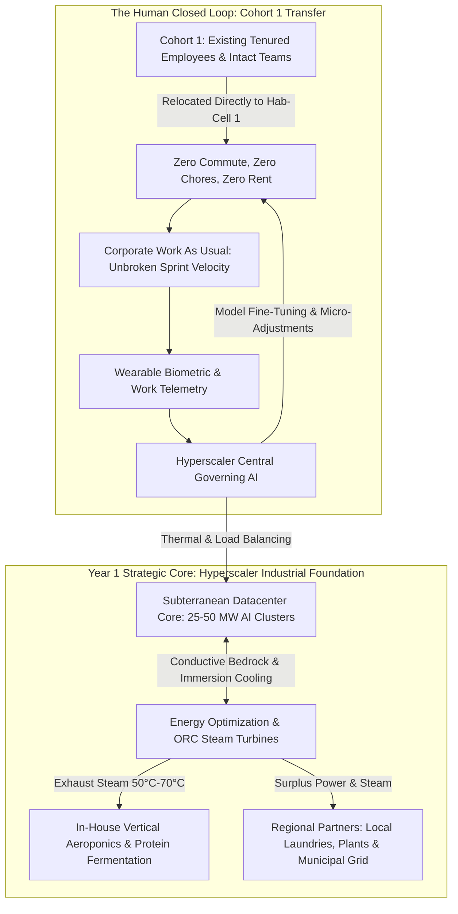
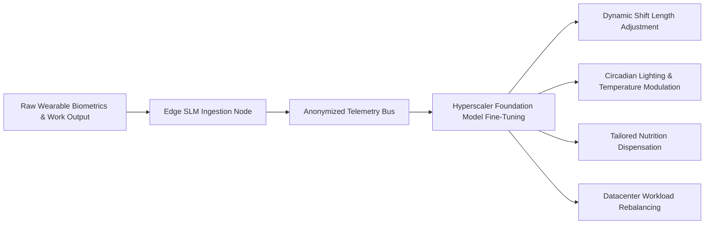

# Year 1 Operational Playbook: Hyperscaler Foundation, Flow Calibration & Physical Triad Stabilization

## 1. Executive Summary & Year 1 Strategic Intent

For an AI hyperscaler enterprise, **Year 1 is not a period of aggressive scaling or open recruitment**. It is the crucible where the core mechanical, thermodynamic, and operational workflows of the enclave are locked into an uninterrupted state of **operational flow**.

The central mission of Year 1 rests on two parallel imperatives:
1. **The Physical Operational Triad**:
   - **Subterranean Datacenter Stabilization**: Locking in continuous AI training clusters and low PUE via conductive bedrock heat-sinking.
   - **Energy Optimization & Steam Routing**: Synchronizing ORC micro-turbines and establishing utility exchanges with regional partners (subsidized steam for cleaning/plants and microgrid peak-shaving).
   - **In-House Food Production**: Stabilizing automated vertical aeroponics and precision fermentation to secure the Tier 0 nutritional floor without external grocery fragility.
2. **The "Work As Usual" Continuity with Transferred Cohort 1**:
   - Transferring **existing tenured employees** first so that corporate product lines, model training pipelines, and engineering sprints continue without interruption.
   - Assimilating real-time human biometric and operational telemetry through the Central Governing AI to make continuous, incremental micro-adjustments to transit, habitat acoustics, meal formulation, and shift schedules.
   - Ironing out physical and computational kinks before any subsequent cohorts arrive.

---

## 2. The Physical Triad: Stabilization Milestones

### 2.1 Subterranean Datacenter Stabilization
- **Continuous AI Supercomputing**:
  - The 25–50 MW subterranean cluster runs mission-critical model training and high-throughput inferencing.
  - Unlike surface facilities vulnerable to heat waves and grid blackouts, the underground cavern provides invariant thermal baseload cooling via graphite/metallurgical conductive bedrock encasement.
- **Year 1 Kink Calibration**:
  - Fine-tuning dielectric immersion fluid flow rates and direct-to-chip microfluidic pressure.
  - Eliminating thermal hotspots across high-density GPU/ASIC compute racks.
  - Ensuring the PUE (Power Usage Effectiveness) reliably hits **1.03 to 1.05**.

### 2.2 Energy Optimization & Steam Exchange
- **Turbine Co-Generation Locking**:
  - Datacenter superheated exhaust ($85^\circ\text{C}\text{--}130^\circ\text{C}$) expands through Organic Rankine Cycle (ORC) micro-turbines, regenerating 15–20% of compute thermal dissipation back into clean electricity.
- **External Regional Steam & Grid Coupling**:
  - Calibrating insulated steam supply pipelines to local partner factories, commercial laundries, and food processing plants.
  - Synchronizing the microgrid intertie with regional utility dispatchers for automated peak-shaving and emergency black-start standby.

### 2.3 In-House Food Production Stabilization
- **Zero-Heating-Cost Agriculture**:
  - Directing medium-grade turbine effluent ($50^\circ\text{C}\text{--}70^\circ\text{C}$) into the aeroponic dome coils to hold root zones at precisely $21^\circ\text{C}\text{--}23^\circ\text{C}$ throughout Year 1 winter conditions.
- **Closed-Loop Yield Targets**:
  - 100% of daily dark leafy greens, culinary herbs, micro-vegetables, and precision fermentation protein isolates produced internally.
  - Establishing baseline nutrient formulas dispensed automatically into Hab-Cell pantries and dining commons.

---

## 3. Human Telemetry Assimilation & "Work As Usual" Continuity

For the corporate hyperscaler, relocating employees into an enclave is not a social experiment; it is an **engineering optimization of productive bandwidth**.

### 3.1 Unbroken Corporate Velocity ("Work As Usual")
- Because Cohort 1 consists of **existing employees** working on established codebases, infrastructure pipelines, and model architectures:
  - There is zero onboarding or hiring drag.
  - Sprints continue seamlessly from Day 1.
  - Workers step out of their Hab-Cells directly into synchronized autonomous transit pods and arrive at their Work-Nodes in minutes.

### 3.2 Continuous Telemetry Feedback & Model Fine-Tuning
The hyperscaler ingests multi-modal human telemetry from the mandatory wearable sensors:
- **Biometric Signals**: Heart Rate Variability (HRV), pulse-wave velocity, sleep architecture, galvanic skin conductance, core temperature.
- **Operational Signals**: Code commit velocity, bug resolution latency, focus block duration, error frequency, shift transition smoothness.

#### Incremental Adjustments Orchestrated by the AI:
1. **Sleep-Wake Optimization**: When telemetry shows poor slow-wave sleep in Hab-Cell Sector B, the AI adjusts ambient HVAC humidity, lowers night-time ambient temperature by $1.2^\circ\text{C}$, and shifts morning acoustic wake chimes by 15 minutes.
2. **Cognitive Fatigue Re-routing**: If an engineering team exhibits high sympathetic nervous system strain after intense debugging, the AI automatically reschedules non-urgent meetings and injects low-cognitive-load maintenance tasks.
3. **Nutritional Customization**: Automated meal dispensers formulate evening recovery shakes with specific electrolyte, zinc, or magnesium dosages based on physical wear and cognitive load measured across the day.

---

## 4. Year 1 Quarterly Milestone Gates

| Quarter | Physical Triad Objectives | Human & Telemetry Objectives |
| :--- | :--- | :--- |
| **Q1: Initial Inhabitation & Cold Boot** | SMR + Geothermal Bedrock baseload locked; primary 25 MW compute cavern online; ORC turbines synchronized. | Transfer first 500 existing employees into Hab-Cell 1; baseline wearable sensors calibrated; zero commute transit active. |
| **Q2: Regional Utility Coupling** | Steam delivery lines to local industrial laundries and plants activated at 50% subsidized rates; regional microgrid intertie tested. | Initial corporate sprint velocity reaches parity with pre-enclave baseline; Edge SLMs automate 90% of daily dining/transit requests. |
| **Q3: Aeroponic Harvest & Loop Closure** | In-house vertical aeroponic domes achieve 100% target fresh produce yield; water recycling hits 96% recovery threshold. | Telemetry feedback loop operational; AI detects and mitigates first fatigue spikes; sprint velocity exceeds external baseline by +15%. |
| **Q4: Kink Resolution & Flow Certification** | Datacenter PUE verified $\le 1.05$; all thermodynamic cascades stable through full winter cycle; zero unplanned outages. | Year 1 review confirms voluntary turnover $<3\%$; employees report $>80\%$ reduction in everyday life stress; hub certified ready for Phase 2 expansion. |

---

## 5. Year 1 "Kinks to Work Out" Risk Register

1. **Acoustic & Vibration Bleed**:
   - *Risk*: High-speed ORC micro-turbines or subterranean datacenter cooling pumps transmitting low-frequency hum into Hab-Cell residential quarters.
   - *Fix*: Decoupled magnetic levitation mounts and active acoustic phase-cancellation nodes installed along subterranean conduit bulkheads.
2. **Habitual Friction & Trust Calibration**:
   - *Risk*: Employees accustomed to driving or cooking manually feel disoriented by total automation.
   - *Fix*: Retention of manual culinary preparation stations in the Civic-Core for recreational cooking, while preserving automated dining as the effortless default.
3. **Telemetry Edge Drift**:
   - *Risk*: Discrepancies between wearable sensor readings and actual subjective fatigue.
   - *Fix*: Weekly brief 30-second qualitative check-ins via Edge SLM interface to cross-calibrate neural networks with self-reported wellness.
